# slide-maker: turn a paper, a repo, a doc, or just a topic into a native PPTX you can present

<p align="center">
  <a href="README_CN.md"><strong>简体中文</strong></a>
</p>

<p align="center">
  <a href="LICENSE"></a>
  
  
  
  <a href="https://skillhub.cloud.tencent.com/skills/slides-maker"></a>
</p>

<p align="center">
  <a href="https://clawhub.ai/dong845/skills/slide-maker"></a>
  <!-- vl:vl-badge --><a href="https://slides.addsum.top/#languages"></a><!-- /vl -->
</p>

<p align="center"><sub>Free and open source, built by <a href="https://addsum.top/"><strong>Addsum</strong></a></sub></p>

> **The slide-maker that reads your actual work, never invents a number, ships fully-editable native PowerPoint, and won't hand it over until an independent critic signs off.**

Chat with it in Codex or Claude Code. It isn't one prompt guessing at slides: a small team of specialized agents reads your paper / repo / doc (or researches the topic when you have none), plans the story, designs each slide around it, builds a real `.pptx`, and puts it through an independent review you size after seeing the first render.

Most AI-PPT tools race to look pretty in seconds. slide-maker optimizes for the four things that actually matter when the deck is *yours to defend*:

- 🔍 **Reads your source — doesn't invent it.** Every number and figure traces back to your material; it won't make up a statistic to fill a slide. (The failure mode of every "expand a topic" tool — one popular assistant printed *43% growth* where the real figure was *12%*.)
- ✏️ **A real PowerPoint, not a screenshot.** Every text box, shape, native chart and equation is a click-to-edit object — *nothing* flattened to an image. (Many "export to PPTX" tools quietly turn a third of your slides into uneditable pictures.)
- 🧑‍⚖️ **Independently reviewed — you size it, deck in hand.** A *separate* critic tries to break the deck — cramped layout, weak contrast, a number that doesn't match the source — and sends fixes back. Not the author model grading its own homework. You pick how hard (or skip it) after seeing the first render.
- 🎨 **Designed around your content, in any language — on any canvas.** Composed slide by slide — matching your template or designing a clean one — for a research talk, a thesis defense, or a product pitch. Not your text poured into a stock layout. And not only 16:9: the same skill recomposes to 4:3, square 1:1, rednote (小红书) 3:4 cards, 9:16 story covers, and A4 print one-pagers, each with its own safe zones and layout logic.

Native-editable PPTX is now table stakes; several tools do it. Rarer is a deck that is editable, source-traced, critic-reviewed and composed for your content at the same time. Honest limits: no zero-setup cloud, no share links, no animated web backgrounds — it makes a **file**, run locally, that opens and edits cleanly in real PowerPoint/Keynote. See [what's different](#what-makes-slide-maker-different).

<p align="center">
  <a href="https://slides.addsum.top/"><strong>Intro video</strong></a> ·
  <a href="#template-library"><strong>Templates</strong></a> ·
  <a href="#what-makes-slide-maker-different"><strong>What's different</strong></a> ·
  <a href="#how-it-works"><strong>How it works</strong></a> ·
  <a href="#quick-start"><strong>Quick start</strong></a> ·
  <a href="#troubleshooting"><strong>Troubleshooting</strong></a>
</p>


## Template library

Choose from <!-- vl:count-all -->thirty<!-- /vl --> PPT templates, each a complete style with its own type, colours and page layouts. Every template has two designed palettes and seven page types: cover, section, image with text, points, quote, data and closing. The pages are recomposed around your material.

<!-- vl:count-image-cap -->Four<!-- /vl --> templates work with your photos or illustrations; <!-- vl:count-drawn -->twenty-six<!-- /vl --> draw their look in native, editable shapes, with no pictures needed. Click a sample to see every page, then ask slide-maker for the template by name.

<!-- vl:vl-gallery -->
<table>
  <tr>
    <td align="center" width="20%">
      <a href="https://slides.addsum.top/#vl-editorial">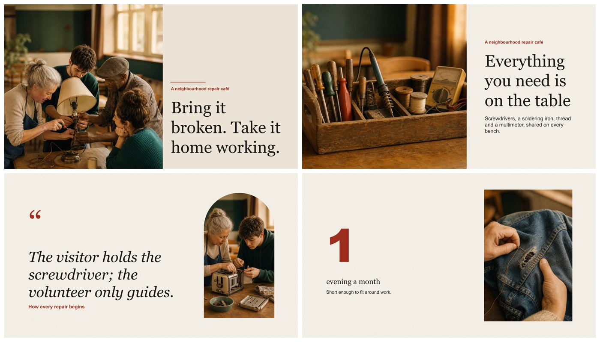</a><br/>
      <sub><strong>Editorial magazine</strong><br/>with your photos<br/>
      <a href="https://slides.addsum.top/#vl-editorial">Preview all pages</a></sub>
    </td>
    <td align="center" width="20%">
      <a href="https://slides.addsum.top/#vl-soft">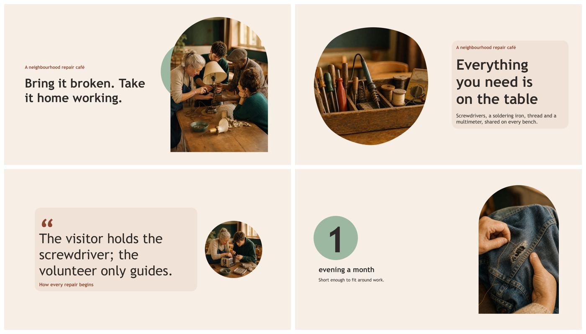</a><br/>
      <sub><strong>Soft organic</strong><br/>with your photos<br/>
      <a href="https://slides.addsum.top/#vl-soft">Preview all pages</a></sub>
    </td>
    <td align="center" width="20%">
      <a href="https://slides.addsum.top/#vl-collage">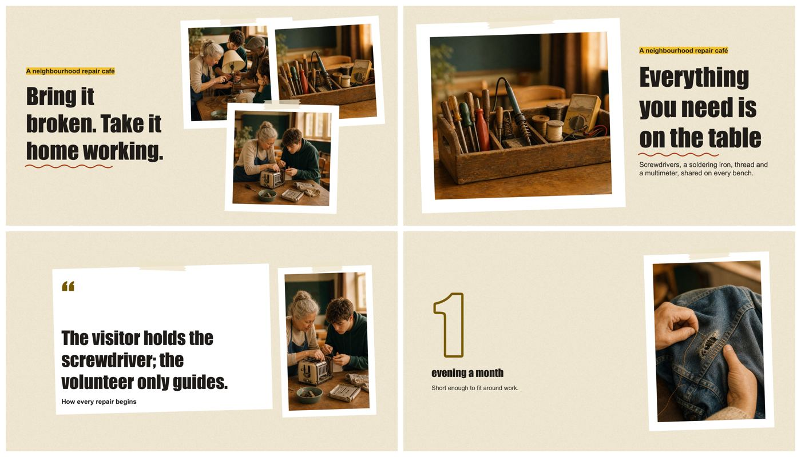</a><br/>
      <sub><strong>Collage scrapbook</strong><br/>with your photos<br/>
      <a href="https://slides.addsum.top/#vl-collage">Preview all pages</a></sub>
    </td>
    <td align="center" width="20%">
      <a href="https://slides.addsum.top/#vl-storybook">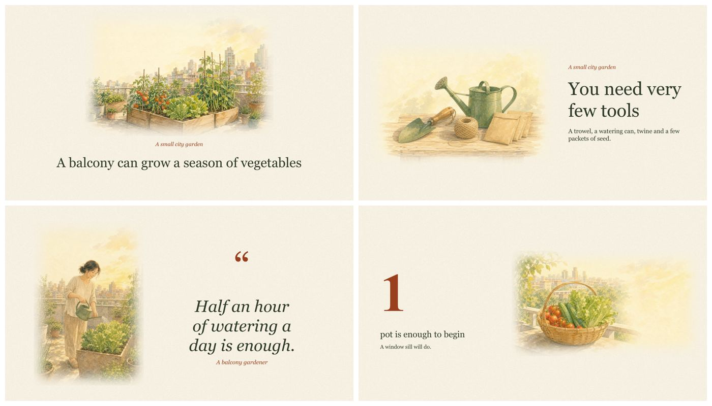</a><br/>
      <sub><strong>Watercolour storybook</strong><br/>with an illustration series<br/>
      <a href="https://slides.addsum.top/#vl-storybook">Preview all pages</a></sub>
    </td>
    <td align="center" width="20%">
      <a href="https://slides.addsum.top/#vl-ink">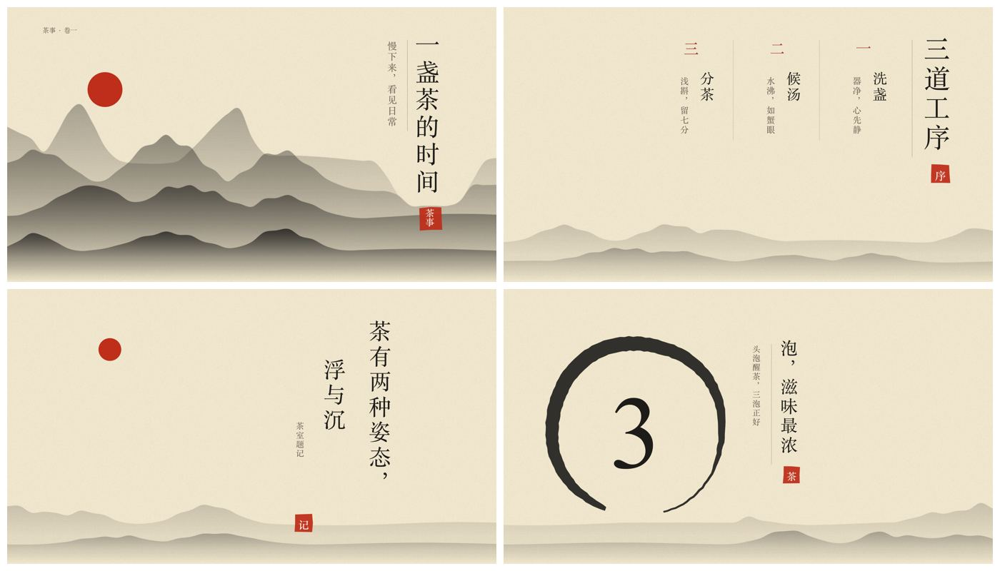</a><br/>
      <sub><strong>Ink wash</strong><br/>culture, history, craft<br/>
      <a href="https://slides.addsum.top/#vl-ink">Preview all pages</a></sub>
    </td>
  </tr>
  <tr>
    <td align="center" width="20%">
      <a href="https://slides.addsum.top/#vl-poster">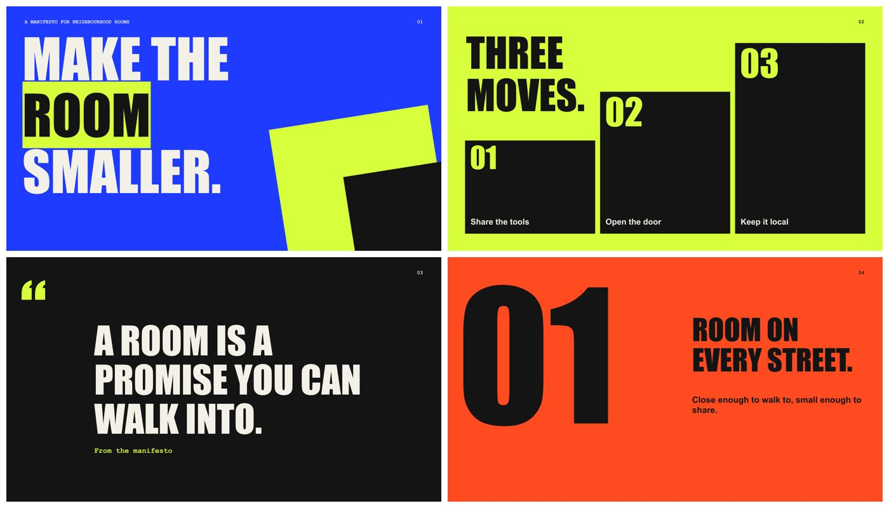</a><br/>
      <sub><strong>Type poster</strong><br/>launch, manifesto, opinion<br/>
      <a href="https://slides.addsum.top/#vl-poster">Preview all pages</a></sub>
    </td>
    <td align="center" width="20%">
      <a href="https://slides.addsum.top/#vl-cutpaper">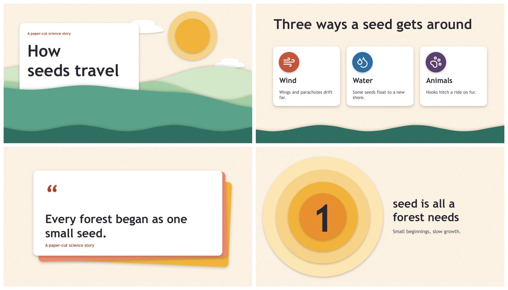</a><br/>
      <sub><strong>Cut paper</strong><br/>children, storytelling, community<br/>
      <a href="https://slides.addsum.top/#vl-cutpaper">Preview all pages</a></sub>
    </td>
    <td align="center" width="20%">
      <a href="https://slides.addsum.top/#vl-drafting">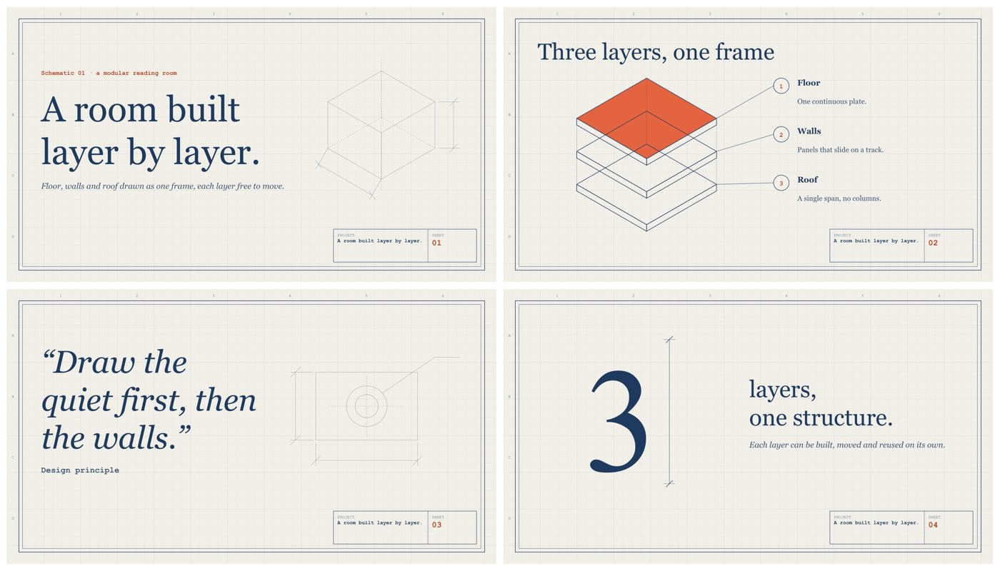</a><br/>
      <sub><strong>Drafting sheet</strong><br/>engineering, architecture, systems design<br/>
      <a href="https://slides.addsum.top/#vl-drafting">Preview all pages</a></sub>
    </td>
    <td align="center" width="20%">
      <a href="https://slides.addsum.top/#vl-starlit">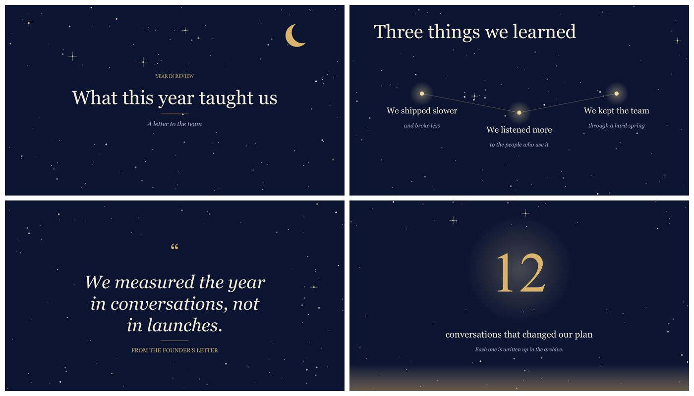</a><br/>
      <sub><strong>Starlit night</strong><br/>year in review, letter, thanks<br/>
      <a href="https://slides.addsum.top/#vl-starlit">Preview all pages</a></sub>
    </td>
    <td align="center" width="20%">
      <a href="https://slides.addsum.top/#vl-broadsheet">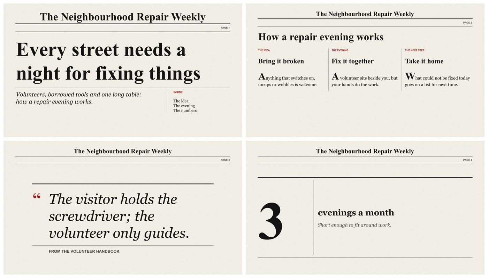</a><br/>
      <sub><strong>Broadsheet front page</strong><br/>newsletter, periodic report, community update<br/>
      <a href="https://slides.addsum.top/#vl-broadsheet">Preview all pages</a></sub>
    </td>
  </tr>
  <tr>
    <td align="center" width="20%">
      <a href="https://slides.addsum.top/#vl-journal">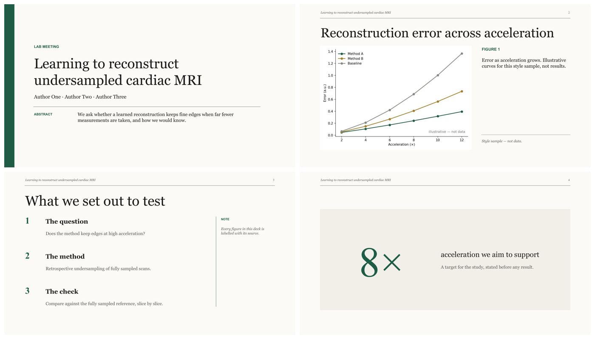</a><br/>
      <sub><strong>Journal article</strong><br/>research talk, lab meeting, paper<br/>
      <a href="https://slides.addsum.top/#vl-journal">Preview all pages</a></sub>
    </td>
    <td align="center" width="20%">
      <a href="https://slides.addsum.top/#vl-tally">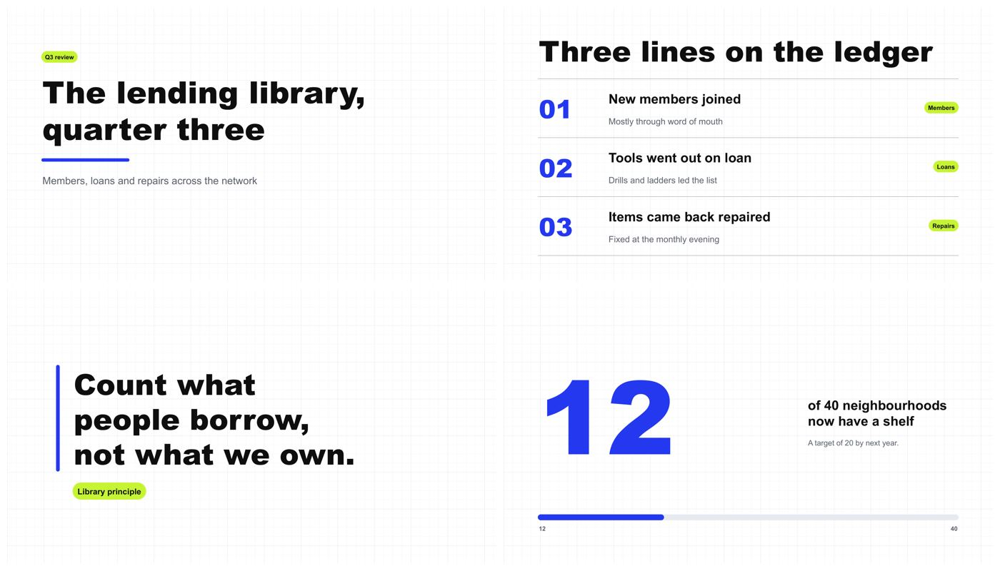</a><br/>
      <sub><strong>Data tally</strong><br/>metrics, quarterly review, operations<br/>
      <a href="https://slides.addsum.top/#vl-tally">Preview all pages</a></sub>
    </td>
    <td align="center" width="20%">
      <a href="https://slides.addsum.top/#vl-chalkboard"></a><br/>
      <sub><strong>Chalkboard</strong><br/>lesson, class, training<br/>
      <a href="https://slides.addsum.top/#vl-chalkboard">Preview all pages</a></sub>
    </td>
    <td align="center" width="20%">
      <a href="https://slides.addsum.top/#vl-interface">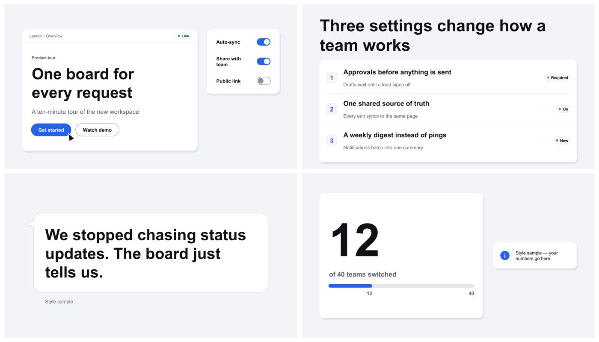</a><br/>
      <sub><strong>Product interface</strong><br/>product launch, app, SaaS<br/>
      <a href="https://slides.addsum.top/#vl-interface">Preview all pages</a></sub>
    </td>
    <td align="center" width="20%">
      <a href="https://slides.addsum.top/#vl-wayfinding">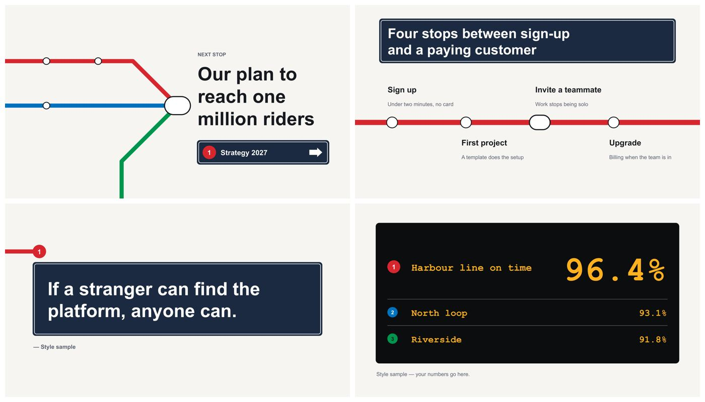</a><br/>
      <sub><strong>Wayfinding</strong><br/>roadmap, process, onboarding<br/>
      <a href="https://slides.addsum.top/#vl-wayfinding">Preview all pages</a></sub>
    </td>
  </tr>
  <tr>
    <td align="center" width="20%">
      <a href="https://slides.addsum.top/#vl-herbarium">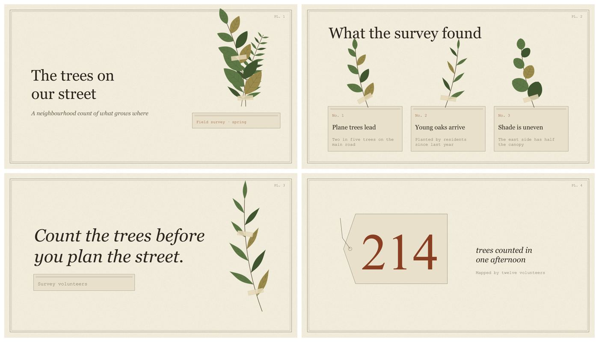</a><br/>
      <sub><strong>Herbarium plate</strong><br/>nature, ecology, sustainability<br/>
      <a href="https://slides.addsum.top/#vl-herbarium">Preview all pages</a></sub>
    </td>
    <td align="center" width="20%">
      <a href="https://slides.addsum.top/#vl-airmail">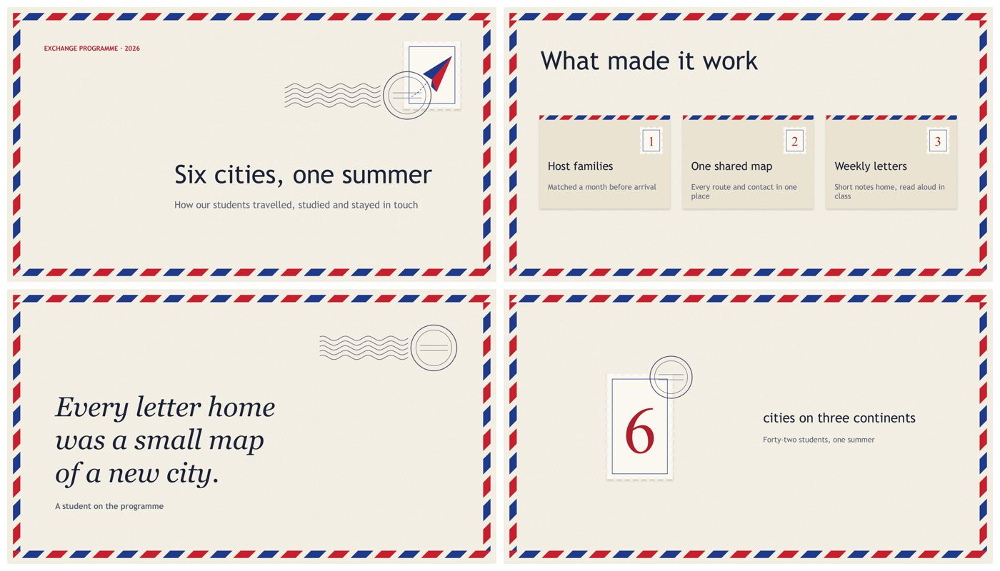</a><br/>
      <sub><strong>Air mail</strong><br/>travel, international, cross-border<br/>
      <a href="https://slides.addsum.top/#vl-airmail">Preview all pages</a></sub>
    </td>
    <td align="center" width="20%">
      <a href="https://slides.addsum.top/#vl-vinyl">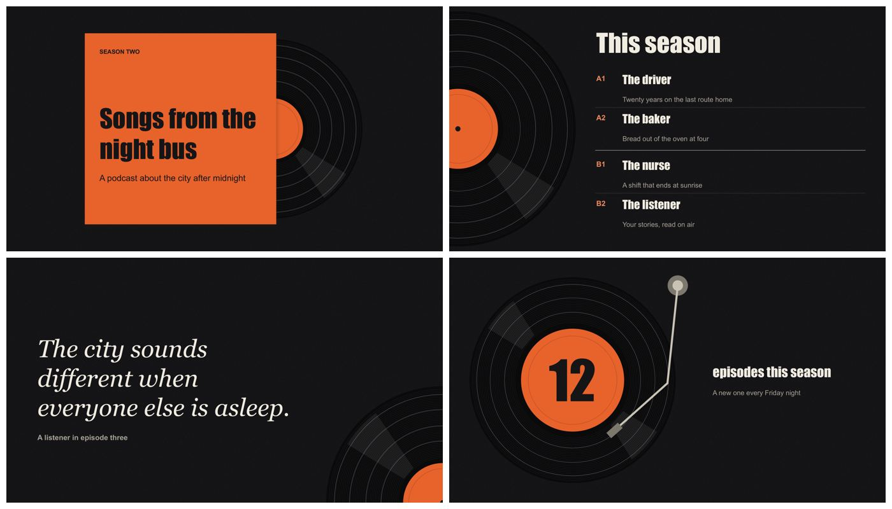</a><br/>
      <sub><strong>Vinyl record</strong><br/>music, podcast, culture<br/>
      <a href="https://slides.addsum.top/#vl-vinyl">Preview all pages</a></sub>
    </td>
    <td align="center" width="20%">
      <a href="https://slides.addsum.top/#vl-receipt">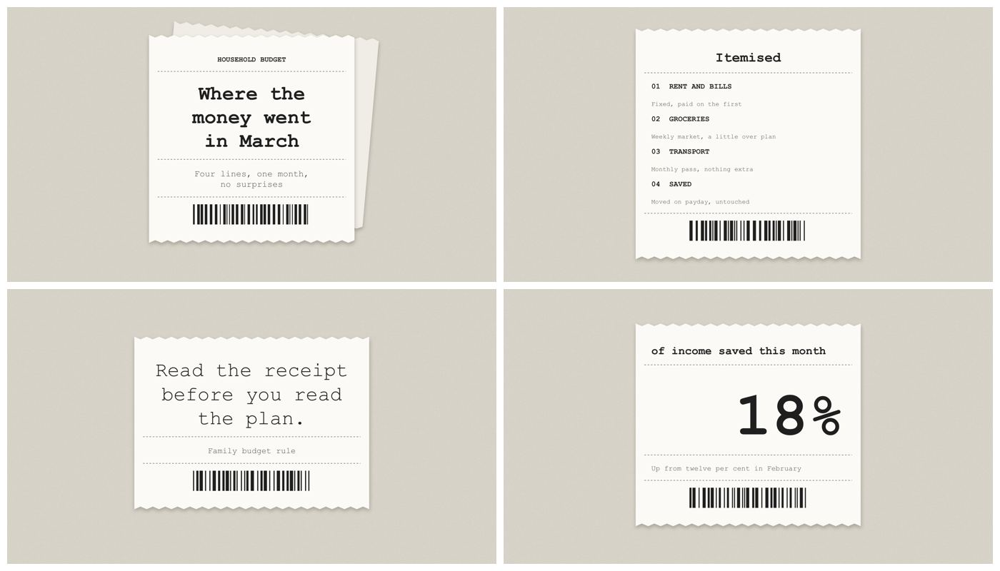</a><br/>
      <sub><strong>Shop receipt</strong><br/>pricing, budget, cost breakdown<br/>
      <a href="https://slides.addsum.top/#vl-receipt">Preview all pages</a></sub>
    </td>
    <td align="center" width="20%">
      <a href="https://slides.addsum.top/#vl-comic">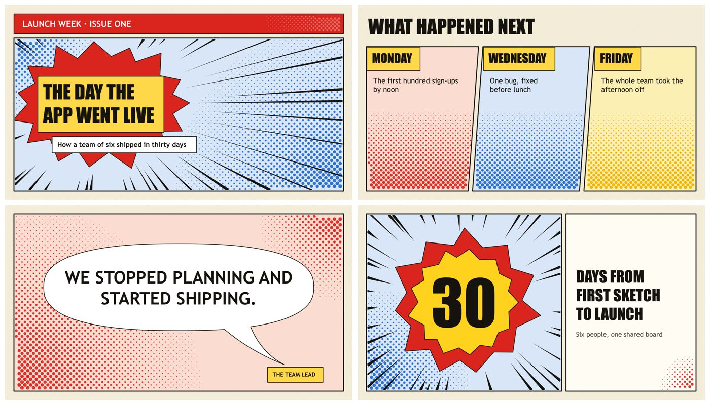</a><br/>
      <sub><strong>Comic panels</strong><br/>storytelling, user journey, explainer<br/>
      <a href="https://slides.addsum.top/#vl-comic">Preview all pages</a></sub>
    </td>
  </tr>
  <tr>
    <td align="center" width="20%">
      <a href="https://slides.addsum.top/#vl-pixel">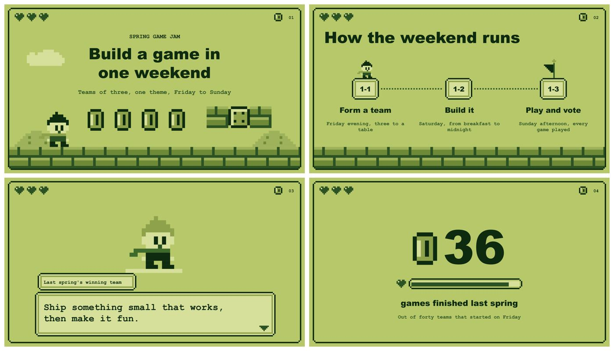</a><br/>
      <sub><strong>Pixel game</strong><br/>games, gamification, hackathon<br/>
      <a href="https://slides.addsum.top/#vl-pixel">Preview all pages</a></sub>
    </td>
    <td align="center" width="20%">
      <a href="https://slides.addsum.top/#vl-bricks">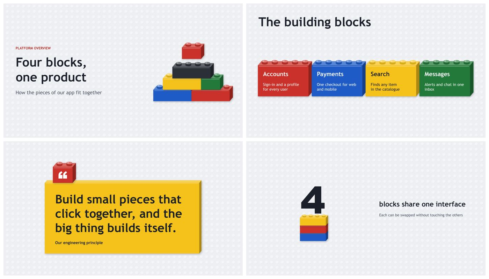</a><br/>
      <sub><strong>Toy bricks</strong><br/>children's education, modular product, system architecture<br/>
      <a href="https://slides.addsum.top/#vl-bricks">Preview all pages</a></sub>
    </td>
    <td align="center" width="20%">
      <a href="https://slides.addsum.top/#vl-boardgame">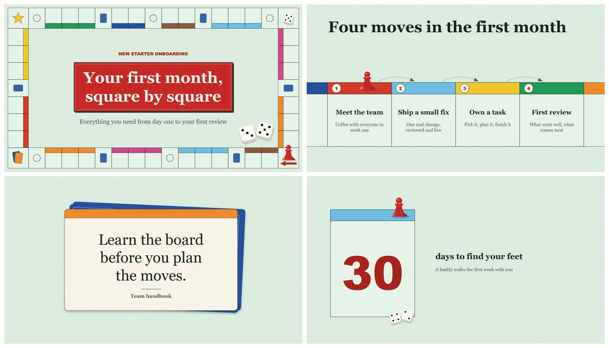</a><br/>
      <sub><strong>Board game</strong><br/>processes, onboarding, strategy<br/>
      <a href="https://slides.addsum.top/#vl-boardgame">Preview all pages</a></sub>
    </td>
    <td align="center" width="20%">
      <a href="https://slides.addsum.top/#vl-circuit">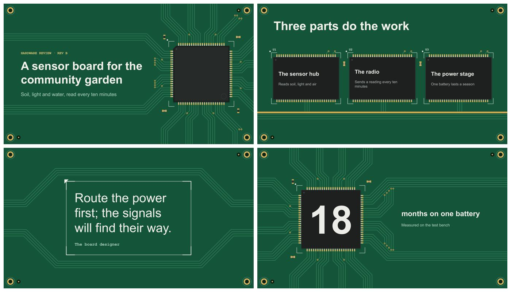</a><br/>
      <sub><strong>Circuit board</strong><br/>hardware, IoT, embedded systems<br/>
      <a href="https://slides.addsum.top/#vl-circuit">Preview all pages</a></sub>
    </td>
    <td align="center" width="20%">
      <a href="https://slides.addsum.top/#vl-topo">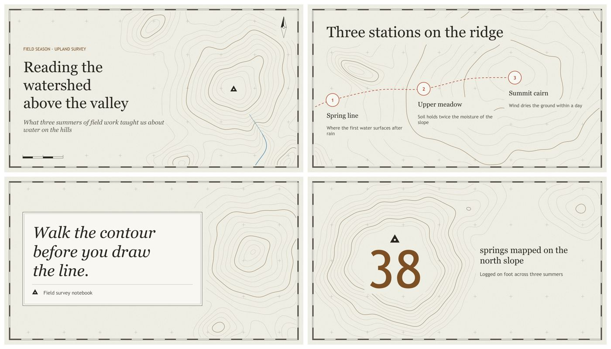</a><br/>
      <sub><strong>Topographic map</strong><br/>geography, outdoors, climate<br/>
      <a href="https://slides.addsum.top/#vl-topo">Preview all pages</a></sub>
    </td>
  </tr>
  <tr>
    <td align="center" width="20%">
      <a href="https://slides.addsum.top/#vl-scoreboard">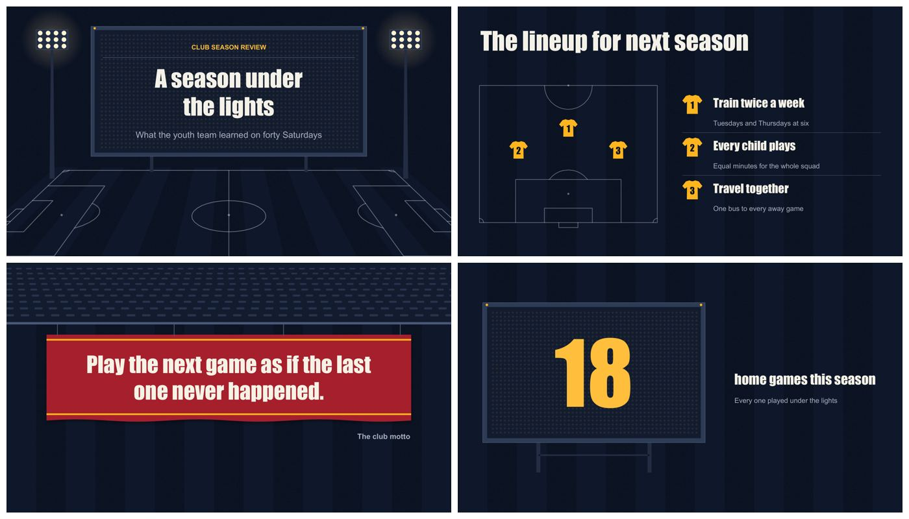</a><br/>
      <sub><strong>Scoreboard</strong><br/>sports, competition, team results<br/>
      <a href="https://slides.addsum.top/#vl-scoreboard">Preview all pages</a></sub>
    </td>
    <td align="center" width="20%">
      <a href="https://slides.addsum.top/#vl-periodic">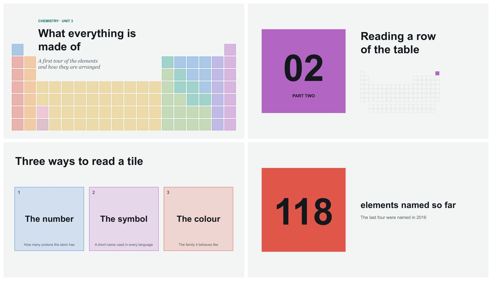</a><br/>
      <sub><strong>Periodic table</strong><br/>science education, chemistry, building blocks of a topic<br/>
      <a href="https://slides.addsum.top/#vl-periodic">Preview all pages</a></sub>
    </td>
    <td align="center" width="20%">
      <a href="https://slides.addsum.top/#vl-recipe">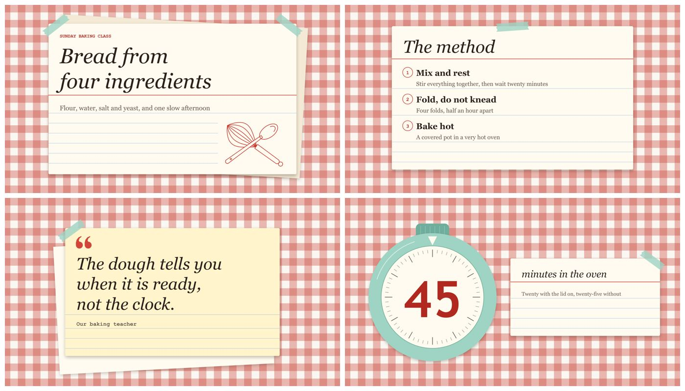</a><br/>
      <sub><strong>Recipe card</strong><br/>food, cooking, recipes<br/>
      <a href="https://slides.addsum.top/#vl-recipe">Preview all pages</a></sub>
    </td>
    <td align="center" width="20%">
      <a href="https://slides.addsum.top/#vl-stainedglass">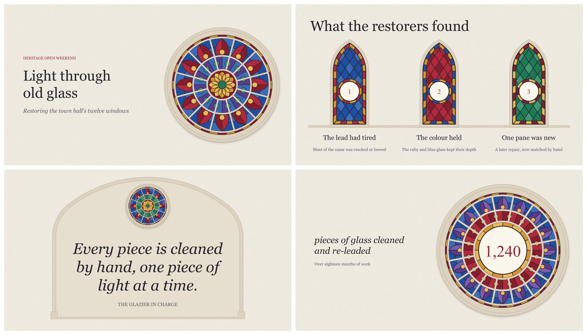</a><br/>
      <sub><strong>Stained glass</strong><br/>heritage, culture, celebrations<br/>
      <a href="https://slides.addsum.top/#vl-stainedglass">Preview all pages</a></sub>
    </td>
    <td align="center" width="20%">
      <a href="https://slides.addsum.top/#vl-calendar">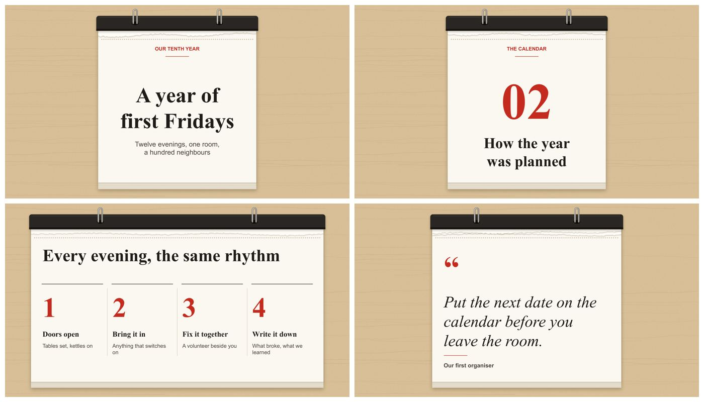</a><br/>
      <sub><strong>Tear-off calendar</strong><br/>timeline, event, anniversary<br/>
      <a href="https://slides.addsum.top/#vl-calendar">Preview all pages</a></sub>
    </td>
  </tr>
</table>
<!-- /vl -->

<p align="center"><a href="https://slides.addsum.top/#languages"><strong>Explore the palettes and pages of all <!-- vl:count-all -->thirty<!-- /vl --> templates online →</strong></a></p>

---

## How to use the templates

Preview a template you like, then give slide-maker your material, audience and slide count. For example:

```text
Use slide-maker with the herbarium (Herbarium plate) template and its light palette.
Turn notes.md into an 8-slide biology lesson for middle-school students.
```

No preferred template? Describe your topic and audience, and it will suggest a few. You can also supply a school or company PPTX template to match its fonts, colours and layouts.


---

## What makes slide-maker different

AI presentation tools roughly fall into four categories. slide-maker only does the last one:

| Category | Output | Editable element by element in PowerPoint? |
| --- | --- | :---: |
| Template fill-in | Content poured into a fixed template | Partially, limited by the template |
| Image-based | One big picture per slide, packed into PPTX | No, each slide is a picture |
| HTML presentation | Slides in a browser | Not a PPTX |
| **Native editable (slide-maker)** | **Real text boxes, shapes, native charts** | **Yes, click anything and edit** |

That table is about the *format*. A handful of newer tools now also emit native-editable PPTX, so "editable" alone no longer sets anything apart. What does: it reads your real material and refuses to invent, it puts the deck through an independent review, and it composes each slide to your content instead of pouring text into a template.

### A small team of agents: separate jobs, separate incentives

slide-maker isn't one prompt doing everything. It's a set of **specialized agents**, each with a single role, deliberately kept independent so that no one mind both builds the deck and grades it:

- **Content-planner**: the lead editor. It does the reading nobody else did and decides what each slide *says* — the takeaway, the evidence, the narrative arc — with every number traced to a source and a coverage gate that guarantees no key point in your material gets silently dropped (each one either lands on a slide or is flagged as consciously cut). Because the whole story flows through one mind, the deck holds together as an argument instead of a pile of slides.
- **Slide-design (art director)**: a separate mind that decides how the approved story *looks* — each slide's visual form, the palette (one meaning per colour, deck-wide), typography, rhythm, icons, and where click-builds actually earn their place. It sketches each page from the content first and only then reaches for the component library, so decks come out designed, not templated.
- **Critic**: an independent reviewer who did not build the deck. It judges the rendered slides through two lenses — content fidelity (a number that doesn't match the source, a key point gone missing) and design (cramped layout, weak contrast, a deck that's compliant but dead) — and sends fixes back. Having no stake in the draft is exactly what makes it honest.
- **Arbiter**: for high-stakes decks, a second independent check that confirms a critic's finding is real before anything changes, so the loop fixes true problems, not noise.
- **Asset-prep**: a build-time executor that materializes the plan's assets (figure crops, equation images, generated plates, icons) in parallel once you've approved the design plan. It makes zero design decisions, so even large decks build fast.

On top of that, it does three things most tools skip:

- **It reads before it draws.** A paper gets read end to end, a repo starts from its README, and when you have no material it researches the topic online first. Every number and figure is traced back to a source, and you confirm a structure draft before any slide is drawn. It will not paste the abstract onto slide one and call it a day.
- **More than text stays editable.** Data charts default to native PowerPoint charts you can double-click and re-number. Formulas are typeset as editable native math text by default, not screenshots (only 2-D layouts like fractions and matrices fall back to a rendered image). Paper figures are cropped from the PDF as-is, never redrawn.
- **Script comes included; motion is yours to choose.** Presentation decks carry a full per-slide script in speaker notes, so you can walk on stage with it. Click builds — revealing a slide one beat at a time — are offered in the interview rather than assumed: say you want a plain click-through and the deck is static, which is the correct result and not a missing feature. When you do want them, it decides *where* they earn their place and stages those slides fully, instead of animating half a page.

One more thing that matters if you iterate a lot: every deck is generated by a build script that ships next to the file. Change the focus, the slide count, or the template with one sentence, and it regenerates cleanly instead of you reworking slides by hand.

And it gets more *yours* over time. When you keep steering a preference the same way across decks — vivid data with quiet chrome, no template-y cards, typeset equations — it records that as a portable taste profile: a plain file you own at the registry root, which you can read, edit, or delete line by line. Future decks read it as a default so you stop re-teaching the same thing. It only ever *seeds* a choice — whatever you say on the current deck always wins — and a brand-new user starts with a clean slate, no assumed style.

It does not promise a perfect deck in one shot. It removes the expensive part — reading the material, planning the structure, laying out pages, making figures, writing the script — and hands you a real file you can keep editing. The polish that remains is yours, which is why the output is native PPTX.

---

## How it works

1. **It asks first.** Who is the audience, how long is the talk, how many slides, live or self-read, what style. Short answers are enough. Say "you decide" if you are in a hurry — it then picks sensible answers itself and posts its picks before building, so a wrong guess costs you one glance, not a rebuild (only a missing topic or source still needs you).
2. **It reads (or researches) the material.** Papers, docs, repos — plus Word / Excel / CSV / images / video / audio, and whole books via purpose-driven triage — are read faithfully, extraction-first (it never guesses a number off pixels): figures cropped from the PDF, key numbers verified line by line, nothing without a source on a slide. With only a topic, it researches current information online first, then works from that.
3. **You approve the story, then the look — right in the chat.** The content-planner posts a compact per-slide table (what each slide says, which figure carries it, how the deck flows), plus the narrative arc it picked and the two it rejected with the reason each lost — so you can overrule the structure, not just the wording. Once you confirm the story, the art director posts the design plan (look, palette, per-slide form, motion) the same way. Two quick confirmations at the two cheapest moments to change direction — no plan files to open.
4. **It generates the PPTX.** Layout is guaranteed by code, with automatic layout checks both at build time and on the rendered output. Overflow, overlap, and font problems get caught there — and so is the rarer failure nobody thinks to check for: **a file PowerPoint refuses to open.** The checks that read geometry and pixels are structurally blind to a malformed part, so the file itself is validated too. Measured on a real build: a duplicated animation element left a deck that saved without error, rendered fine, and passed every layout check — the first sign would have been PowerPoint offering to "repair" it, in front of the user.
5. **You see the render, then an independent critic reviews it.** The rendered deck is posted first, and you pick the review effort with it in front of you — `fast` (the default) up to `thorough`, or `none` if it's already what you wanted. The critic agent (with an arbiter cross-checking on high-stakes decks) judges the slides against presentation standards; fixes land, the deck is re-checked, and only then is it delivered to `~/Downloads/<deck-name>/`. The PDF and the browser preview are generated at hand-off rather than on every build (a deck still being edited makes them stale immediately) — and they are **gated on a record that the review actually ran**, because the model that skips a check is the same model that would write the note claiming it didn't.
6. **You tune it in plain language.** Not perfect? Just say so in the chat ("turn slide 7 into a chart," "cut the intro," "warmer palette," "make it 10 slides," "shorten the notes") and it rebuilds cleanly from the same script. No dragging boxes by hand; keep refining until it's right.

**What it costs:** the tool is free; you pay only your AI usage. Reading, planning and building is the cheap part — **the independent review loop is where the tokens go**, so it's asked as one question after the first render, with the deck in front of you:

| `review:` | what runs | measured |
| --- | --- | --- |
| `fast` (default) | 1 generalist critic, 1 round, top-5 claims fact-checked | ~6 subagents · ~250k tokens · ~10–20 min |
| `standard` | 2 focused critics (content + design), 2 rounds, top-10 claims | ~12 · ~600k · ~30–60 min |
| `thorough` | multi-critic panel + arbiter cross-check, 3 rounds, every claim | ~32 · ~2M · ~1–2 h |
| `none` | no review — happy with what you see, take it as-is | 0 |

<sub>Figures from one 12-page deck, July 2026 — orders of magnitude.</sub>

---

## Quick start

<p align="center">
  
</p>

### Step 1: Install

> **Prefer a marketplace? slide-maker is also published on
> [Tencent SkillHub](https://skillhub.cloud.tencent.com/skills/slides-maker) and
> [ClawHub](https://clawhub.ai/dong845/skills/slide-maker) — the last one installs straight into
> [OpenClaw](https://openclaw.ai), so OpenClaw users get slide-maker too** —
> grab it there by following each page's install instructions, then come back for the runtime
> dependencies below (they apply however you install).

slide-maker relies on three system tools: **Python 3.9+**, **LibreOffice** (renders slide previews for the automatic layout checks), and **one SVG rasterizer** for icons (librsvg, cairosvg, or any Chrome-family browser). Install them for your OS:

| OS | LibreOffice | Icon rasterizer |
| --- | --- | --- |
| macOS | `brew install --cask libreoffice` | `brew install librsvg` |
| Linux | `sudo apt install libreoffice` | `sudo apt install librsvg2-bin` |
| Windows | `winget install TheDocumentFoundation.LibreOffice` | Chrome or Edge installed (used headless) |

(Windows works too; we just test it less, so if you hit an environment quirk, run `check_env.py` below to self-diagnose or open an issue with the error.)

**With those system tools in place, install slide-maker itself.** The four lines below clone the repo, install its Python packages, and register it as a skill:

```bash
git clone --depth 1 https://github.com/addsumtech/slides_maker.git
cd slides_maker
python3 -m pip install -r skills/slide-maker/requirements.txt
python3 skills/slide-maker/scripts/install_skill.py --target both
```

If you only use one tool, replace `both` with `codex` or `claude`. Not sure what's missing? The [check command](#troubleshooting) prints the exact fix.

**Prefer a one-liner? Install just the skill with [`npx skills`](https://github.com/vercel-labs/skills)** (no clone, about 1.1 MB):

```bash
npx skills add addsumtech/slides_maker
```

It prompts for the agent and scope. The skill and its built-in templates live under `skills/slide-maker/`; online previews and complete example decks live in [slides_maker-site](https://github.com/addsumtech/slides_maker-site). Add `-g` to install globally (all projects), `-a claude-code` (or `-a codex`) to skip the agent prompt, and `-y` for a fully non-interactive run. You still need the runtime dependencies above: LibreOffice, an SVG rasterizer, and `python3 -m pip install -r skills/slide-maker/requirements.txt`.

**On Claude Code, you can also add it as a plugin** so it stays updated with a normal plugin command:

```text
/plugin marketplace add addsumtech/slides_maker
/plugin install slide-maker@slides-maker
```

This is the same skill, just managed by Claude Code's plugin system instead of copied into your skills folder. The runtime dependencies above still apply.

### Keeping it up to date

slide-maker checks before it asks you anything, and **stays completely silent when you are current**. When a newer version exists it does not update itself and does not just mention it — it asks, once, at the top:

- **yes** — it updates for you, then builds the whole deck on the new version. You don't need to know how you installed it: it works that out and runs the right command itself.
- **no** — don't update; build on the version you already have installed.
- **other** — you have local changes. It shows you what is yours and what is incoming, and resolves nothing on its own.

The remote lookup is cached for 24 hours, but whether *you* have uncommitted work is re-read every time — a day-old "your tree is clean" is exactly the reading that gets someone's edits overwritten. Offline, it stays quiet rather than getting in the way.

Don't want to be told: `export SLIDE_MAKER_NO_VERSION_CHECK=1`.

### Step 2: Invoke it and answer the interview (the recommended path)

The best, most reliable result comes from **invoking the skill and answering its short interview step by step**:

```text
/slide-maker
```

The interview opens as a clickable, tabbed form (Topic · Template · Purpose & Audience · Style & Language): arrow keys to move, Enter to pick, and every question ships with ready-made options. It recognizes returning users, too: saved templates and past topics show up as one "use one of my previous ones" choice beside the general options, expanding only if you pick it. **Answering each question is what makes the deck yours instead of generic**: audience, length, live-vs-self-read, density, language, and look all steer the plan. Short answers are fine, and **"you decide" is always a valid answer**. (Review effort isn't asked here — you choose it after the first render, deck in hand.)

**In a hurry? A one-liner works too, but treat it as a shortcut, not the best path:**

```text
Use slide-maker to create a PPT from paper.pdf.
```

It starts straight from your file and skips the topic question, which is convenient. But every question you don't answer becomes an assumption the skill has to make, so you'll usually spend more time tuning afterward. **When the deck matters, answer the interview.** (In Codex there's no slash command; the same questions arrive as plain text. Fully supported, just less clicking. Claude Code is the smoother ride.)

Either way, what follows is a short conversation, not a prompt-writing exercise:

```text
It:   Before I build: which template? Who is the audience, how long,
      live or self-read? Is this PDF the only source?
      English or Chinese, visual-first or balanced?

You:  For my advisor and labmates, 12 minutes, live. Only paper.pdf.
      English, visual and concise. You pick the look.

It:   (after reading the paper) Here is the plan: 15 slides.
      Slide 4 places the paper's Figure 1 whole; the results page
      becomes a native chart you can re-number...
      Confirm the direction and I will build.
```

- **You pick the look before the deck is built — you don't have to ask.** When slide-maker is designing from scratch (you have no template of your own), it renders **four style directions** into one browser link and waits for you to choose. At least one of the four is a **register invented for your topic** rather than a stock preset, and a mechanical check rejects a set whose options are four coats of the same paint — so it is a real choice, not a formality.
- Put your material in the current project, or give a full path in the request. **No material at all?** Give it a topic; it researches online first, then agrees on a structure with you.

Other ways to open:

```text
Use slide-maker to create a technical presentation from this repository.
```

```text
I have a reference PPT: /path/ref.pptx. Use its visual style only, not its content,
and make a new English deck from paper.pdf.
```

### Optional: AI image generation

If you want a generated cover, page illustrations, or a full generated visual identity, say "use AI image generation" in the chat. Two ways to power it, either works: a Codex subscription uses its built-in image generation with no key, or set an OpenAI API key to go through the API. With neither, slide-maker still produces fully editable PPTX.

---

## Best-fit scenarios

Research talks are the home turf, because it parses the problem, method, results, figures, tables, and equations in a paper. But whenever material needs to be explained clearly (or when you have only a topic and no material yet), it can give you a first deck you can present and keep editing.

| What you have | What you can make |
| --- | --- |
| Papers, experiment results, paper figures | Lab meeting & paper reading, conference oral talk, poster, proposal, thesis defense, experiment report |
| Code repositories, README files, technical docs | Lab meeting, repo walkthrough, architecture talk, progress update, engineering recap |
| Course material, product docs, market data | Class talk, product introduction, market analysis, proposal |
| Nothing yet, just a topic in your head | Hand it a topic; the agents research current information online, agree on a structure with you, then build the deck from scratch |
| A reference PPT | New topic, new content, reorganized story: its look, your material |
| A story that needs to live beyond 16:9 | rednote (小红书) 3:4 image notes, square 1:1 posts, 9:16 story covers, 4:3 venue decks, A4 print one-pagers — same identity and components, recomposed per surface with platform safe zones |

---

## Troubleshooting

If generation or preview rendering fails, run the check for your environment. Most failures are missing Python dependencies or LibreOffice:

```bash
# Codex
python3 ~/.codex/skills/slide-maker/scripts/check_env.py

# Claude Code
python3 ~/.claude/skills/slide-maker/scripts/check_env.py
```

It prints the exact fix for anything missing.

For everything beyond the environment — build errors, lint findings and what they mean in plain language, render failures, image sourcing, CJK issues — there is a dedicated symptom → cause → fix page: [**Troubleshooting & FAQ**](skills/slide-maker/references/troubleshooting-faq.md). Failing lint runs print a pointer to it. If a problem isn't covered there, open an issue with the error output.

---

## Security

No credentials are stored or hardcoded anywhere in this repository, and CI scans every push — working tree *and* full history — for credential shapes rather than prefixes. If a scanner reported an `sk-` key here, it matched a CSS class name (`sk-body`, `sk-split`, `sk-rail` — `sk-` is short for *skeleton*); [**SECURITY.md**](SECURITY.md) shows how to confirm that in ten seconds, and how to report anything real.

---

## License

[MIT](LICENSE)
