# slide-maker：把论文、代码库、文档，甚至只是一个主题，变成能直接开讲的原生 PPTX

<p align="center">
  <a href="README.md"><strong>English</strong></a>
</p>

<p align="center">
  <a href="LICENSE"></a>
  
  
  
  <a href="https://skillhub.cloud.tencent.com/skills/slides-maker"></a>
</p>

<p align="center">
  <a href="https://clawhub.ai/dong845/skills/slide-maker"></a>
  <!-- vl:vl-badge-zh --><a href="https://slides.addsum.top/cn/#languages"></a><!-- /vl -->
</p>

<p align="center"><sub><a href="https://addsum.top/cn/"><strong>增和科技 Addsum</strong></a> 出品 · 免费开源</sub></p>

> **一个会读你真实材料、绝不编造数字、输出真正可编辑的原生 PowerPoint、并且要等独立评审点头才交付的 AI 做 PPT 工具。**

在 Codex 或 Claude Code 里聊几句就行。它不是一句 prompt 瞎猜幻灯片：一支各司其职的 **agent 团队**先读懂你的论文、代码、文档（没有材料就先联网调研），规划故事线，围绕它设计每一页，生成一份真正的 `.pptx`，先把渲染稿给你看，再按你定的力度交给独立评审过一遍。

多数 AI-PPT 工具都在拼「几秒出漂亮 PPT」。但当这份 deck 是**你要拿去讲、要负责**的东西时，真正重要的是另外四件事，slide-maker 做的就是这四件：

- 🔍 **读你的材料，不编造。** 每个数字、每张图都能溯源到你的材料；绝不为了填满一页瞎编一个统计数字（这是所有「把主题铺开」类工具的通病，某个流行助手就把真实的 **12%** 印成了 **43%**）。
- ✏️ **一份真 PowerPoint，不是截图。** 每个文本框、形状、原生图表、公式都是点开就能改的对象，**没有任何**东西被压成图片（很多号称「导出 PPTX」的工具，会悄悄把三分之一的页面变成改不动的图）。
- 🧑‍⚖️ **独立评审，力度你定。** 由一个**独立**评审去挑毛病，版式挤压、对比度不足、数字和原文对不上，挑出来就打回重修。不是作者模型给自己批卷。审多严（或者不审）由你在看到第一版渲染稿之后决定。
- 🎨 **围绕你的内容设计，任意语言、任意画布。** 每一页都是现场编排出来的，你有模板就匹配你的模板，没有就现设计一套干净的，研究报告、答辩、产品 pitch 都行，不是把你的文字倒进现成版式。而且不止 16:9：同一套技能可以重排成 4:3、方形 1:1、小红书 3:4 图文卡、9:16 竖版封面、A4 打印一页纸，每种画布都有自己的安全区和排版逻辑。

原生可编辑 PPTX 如今已是基本盘，不少工具都能做。稀缺的是可编辑、溯源不编造、审校过、按你的内容单独编排这几件事同时成立，而且落在一份归你所有的文件里。也把话说在前面：它没有零配置云端、没有分享链接、没有动态网页背景，它交付的是一个**本地生成的文件**，能在真的 PowerPoint 和 Keynote 里干净打开、继续编辑。详见[不一样在哪](#slide-maker-不一样在哪)。

<p align="center">
  <a href="https://slides.addsum.top/cn/"><strong>视频介绍</strong></a> ·
  <a href="#模板库"><strong>模板库</strong></a> ·
  <a href="#slide-maker-不一样在哪"><strong>不一样在哪</strong></a> ·
  <a href="#它是怎么干活的"><strong>工作流程</strong></a> ·
  <a href="#快速开始"><strong>快速开始</strong></a> ·
  <a href="#遇到问题"><strong>遇到问题</strong></a>
</p>


## 模板库

<!-- vl:count-all-zh -->三十<!-- /vl -->套可直接点名使用的 PPT 模板，每套都有自己的字体、配色和页面版式。每套提供两种配色，以及封面、章节、图文、要点、引语、数据、结尾七类页面，按你的材料重新排版。

其中<!-- vl:count-image-zh -->四<!-- /vl -->套适合搭配照片或插画，<!-- vl:count-drawn-zh -->二十六<!-- /vl -->套用可编辑的原生形状绘制，没有配图也能做。点击样张查看完整页面，选好后直接告诉 slide-maker 模板名称。

<!-- vl:vl-gallery-zh -->
<table>
  <tr>
    <td align="center" width="20%">
      <a href="https://slides.addsum.top/cn/#vl-editorial"></a><br/>
      <sub><strong>杂志</strong><br/>配你的照片<br/>
      <a href="https://slides.addsum.top/cn/#vl-editorial">查看全部页面</a></sub>
    </td>
    <td align="center" width="20%">
      <a href="https://slides.addsum.top/cn/#vl-soft">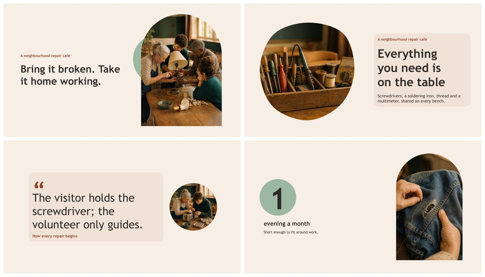</a><br/>
      <sub><strong>柔和</strong><br/>配你的照片<br/>
      <a href="https://slides.addsum.top/cn/#vl-soft">查看全部页面</a></sub>
    </td>
    <td align="center" width="20%">
      <a href="https://slides.addsum.top/cn/#vl-collage">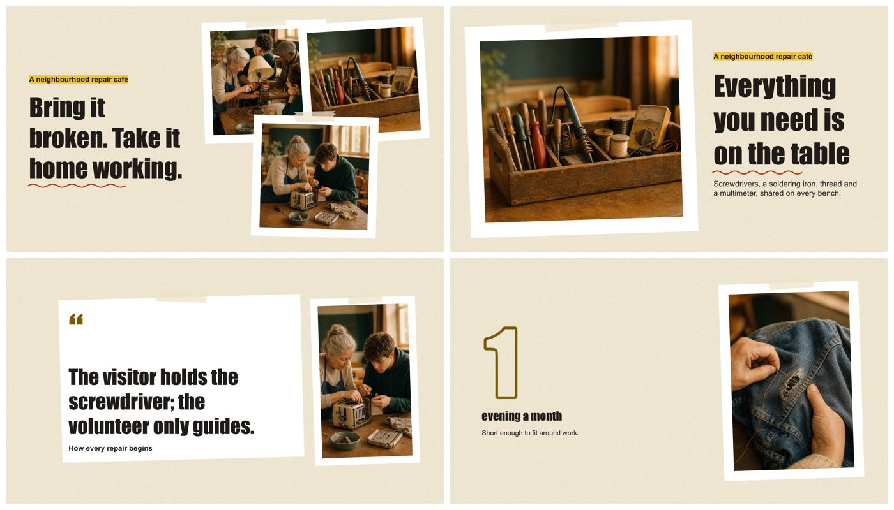</a><br/>
      <sub><strong>拼贴</strong><br/>配你的照片<br/>
      <a href="https://slides.addsum.top/cn/#vl-collage">查看全部页面</a></sub>
    </td>
    <td align="center" width="20%">
      <a href="https://slides.addsum.top/cn/#vl-storybook"></a><br/>
      <sub><strong>绘本</strong><br/>配一组插画<br/>
      <a href="https://slides.addsum.top/cn/#vl-storybook">查看全部页面</a></sub>
    </td>
    <td align="center" width="20%">
      <a href="https://slides.addsum.top/cn/#vl-ink"></a><br/>
      <sub><strong>水墨</strong><br/>文化、历史、器物<br/>
      <a href="https://slides.addsum.top/cn/#vl-ink">查看全部页面</a></sub>
    </td>
  </tr>
  <tr>
    <td align="center" width="20%">
      <a href="https://slides.addsum.top/cn/#vl-poster"></a><br/>
      <sub><strong>海报大字</strong><br/>发布会、宣言、观点<br/>
      <a href="https://slides.addsum.top/cn/#vl-poster">查看全部页面</a></sub>
    </td>
    <td align="center" width="20%">
      <a href="https://slides.addsum.top/cn/#vl-cutpaper">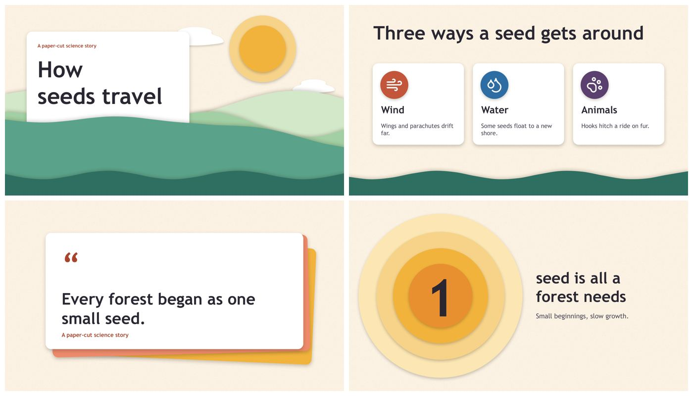</a><br/>
      <sub><strong>剪纸层叠</strong><br/>儿童、讲故事、社区<br/>
      <a href="https://slides.addsum.top/cn/#vl-cutpaper">查看全部页面</a></sub>
    </td>
    <td align="center" width="20%">
      <a href="https://slides.addsum.top/cn/#vl-drafting">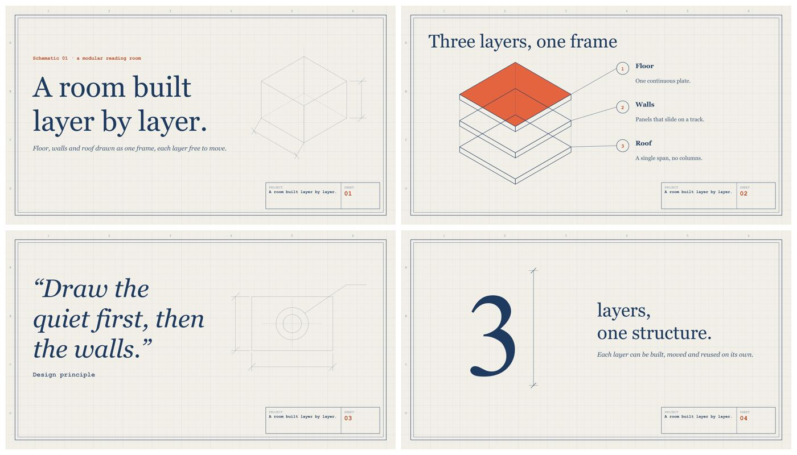</a><br/>
      <sub><strong>蓝图技术线稿</strong><br/>工程、建筑、系统设计<br/>
      <a href="https://slides.addsum.top/cn/#vl-drafting">查看全部页面</a></sub>
    </td>
    <td align="center" width="20%">
      <a href="https://slides.addsum.top/cn/#vl-starlit">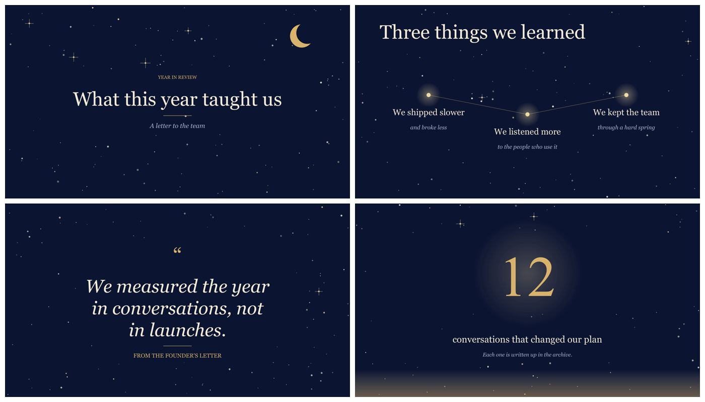</a><br/>
      <sub><strong>星夜</strong><br/>年度回顾、书信、致谢<br/>
      <a href="https://slides.addsum.top/cn/#vl-starlit">查看全部页面</a></sub>
    </td>
    <td align="center" width="20%">
      <a href="https://slides.addsum.top/cn/#vl-broadsheet">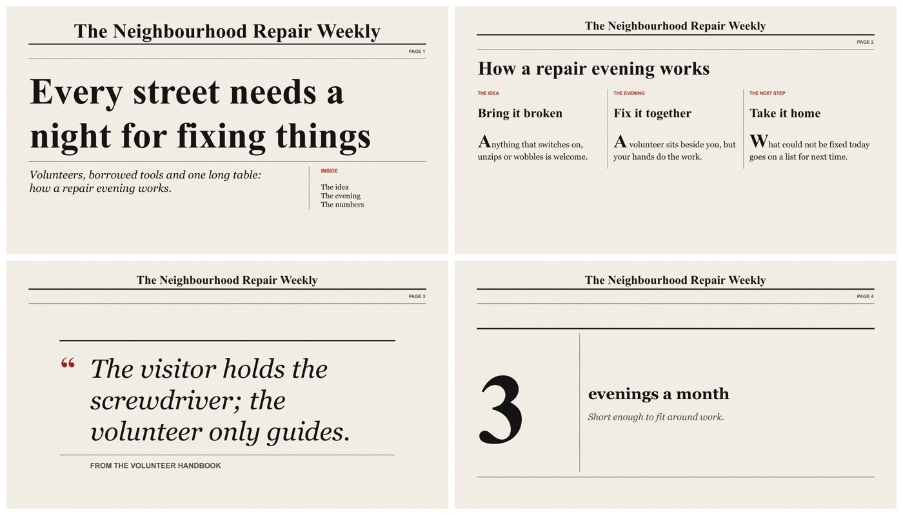</a><br/>
      <sub><strong>报纸头版</strong><br/>通讯、定期报告、社区动态<br/>
      <a href="https://slides.addsum.top/cn/#vl-broadsheet">查看全部页面</a></sub>
    </td>
  </tr>
  <tr>
    <td align="center" width="20%">
      <a href="https://slides.addsum.top/cn/#vl-journal">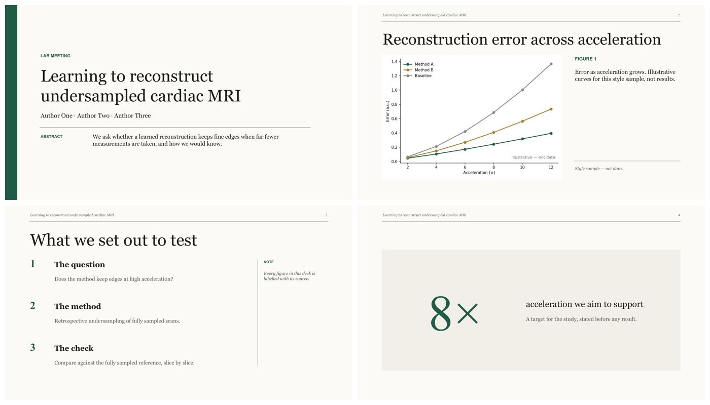</a><br/>
      <sub><strong>学术期刊</strong><br/>学术报告、组会、论文<br/>
      <a href="https://slides.addsum.top/cn/#vl-journal">查看全部页面</a></sub>
    </td>
    <td align="center" width="20%">
      <a href="https://slides.addsum.top/cn/#vl-tally">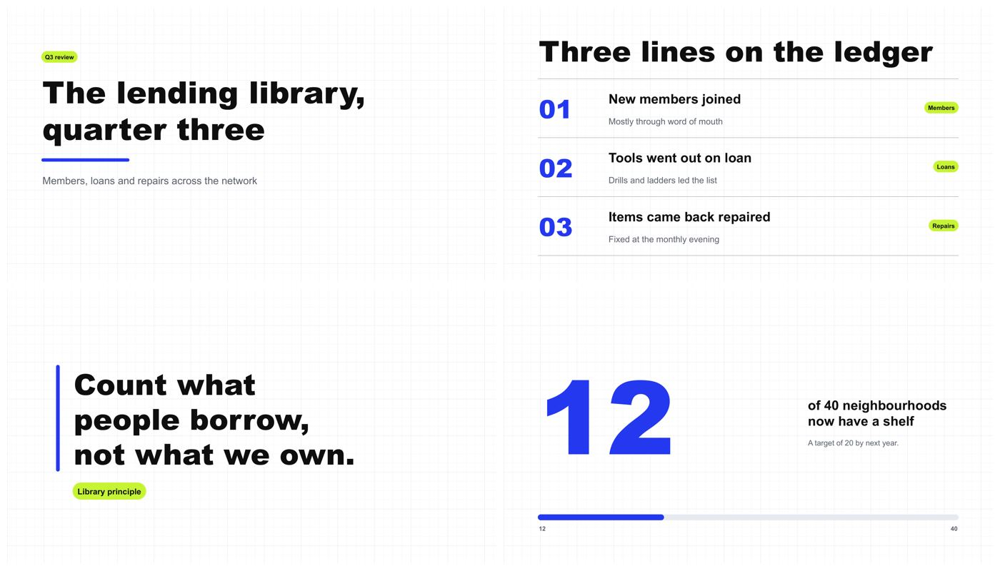</a><br/>
      <sub><strong>数据账本</strong><br/>指标、季度复盘、运营<br/>
      <a href="https://slides.addsum.top/cn/#vl-tally">查看全部页面</a></sub>
    </td>
    <td align="center" width="20%">
      <a href="https://slides.addsum.top/cn/#vl-chalkboard"></a><br/>
      <sub><strong>黑板报</strong><br/>课程、课堂、培训<br/>
      <a href="https://slides.addsum.top/cn/#vl-chalkboard">查看全部页面</a></sub>
    </td>
    <td align="center" width="20%">
      <a href="https://slides.addsum.top/cn/#vl-interface">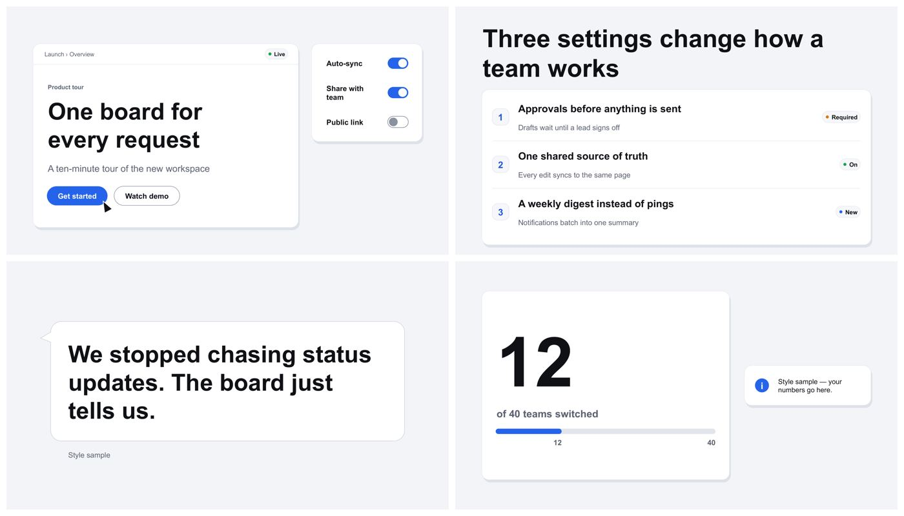</a><br/>
      <sub><strong>产品界面</strong><br/>产品发布、应用、SaaS<br/>
      <a href="https://slides.addsum.top/cn/#vl-interface">查看全部页面</a></sub>
    </td>
    <td align="center" width="20%">
      <a href="https://slides.addsum.top/cn/#vl-wayfinding"></a><br/>
      <sub><strong>导视线路</strong><br/>路线图、流程、新人上手<br/>
      <a href="https://slides.addsum.top/cn/#vl-wayfinding">查看全部页面</a></sub>
    </td>
  </tr>
  <tr>
    <td align="center" width="20%">
      <a href="https://slides.addsum.top/cn/#vl-herbarium">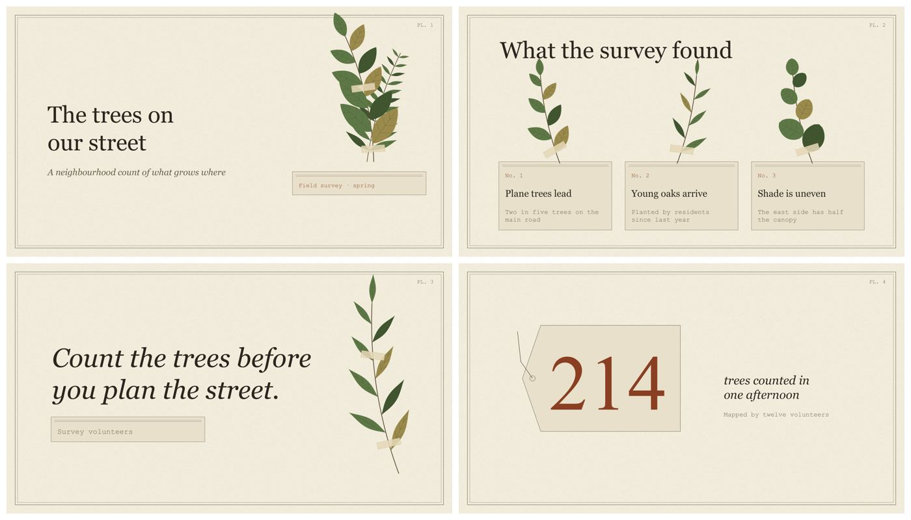</a><br/>
      <sub><strong>标本图鉴</strong><br/>自然、生态、可持续<br/>
      <a href="https://slides.addsum.top/cn/#vl-herbarium">查看全部页面</a></sub>
    </td>
    <td align="center" width="20%">
      <a href="https://slides.addsum.top/cn/#vl-airmail">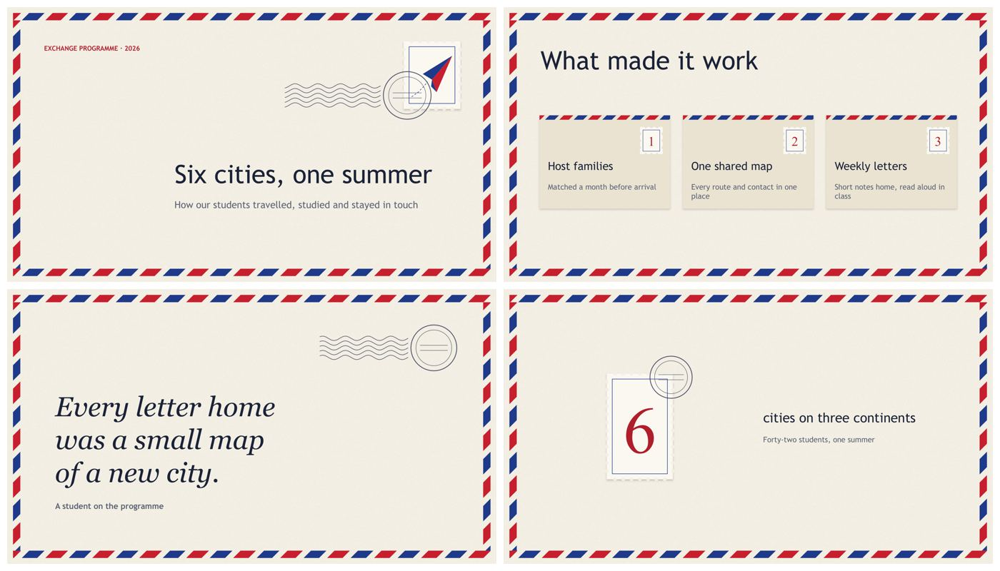</a><br/>
      <sub><strong>航空邮件</strong><br/>旅行、国际化、跨境<br/>
      <a href="https://slides.addsum.top/cn/#vl-airmail">查看全部页面</a></sub>
    </td>
    <td align="center" width="20%">
      <a href="https://slides.addsum.top/cn/#vl-vinyl"></a><br/>
      <sub><strong>黑胶唱片</strong><br/>音乐、播客、文化活动<br/>
      <a href="https://slides.addsum.top/cn/#vl-vinyl">查看全部页面</a></sub>
    </td>
    <td align="center" width="20%">
      <a href="https://slides.addsum.top/cn/#vl-receipt">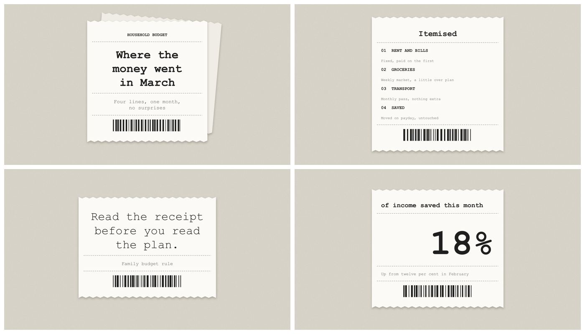</a><br/>
      <sub><strong>购物小票</strong><br/>定价、预算、成本拆解<br/>
      <a href="https://slides.addsum.top/cn/#vl-receipt">查看全部页面</a></sub>
    </td>
    <td align="center" width="20%">
      <a href="https://slides.addsum.top/cn/#vl-comic"></a><br/>
      <sub><strong>漫画分镜</strong><br/>讲故事、用户旅程、科普讲解<br/>
      <a href="https://slides.addsum.top/cn/#vl-comic">查看全部页面</a></sub>
    </td>
  </tr>
  <tr>
    <td align="center" width="20%">
      <a href="https://slides.addsum.top/cn/#vl-pixel">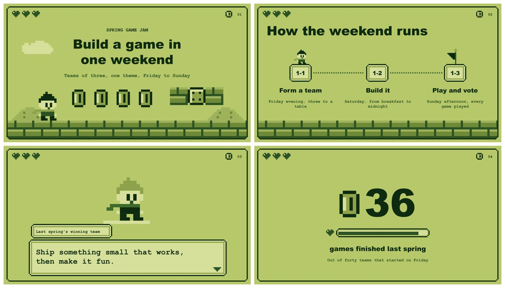</a><br/>
      <sub><strong>像素游戏</strong><br/>游戏、游戏化、黑客松<br/>
      <a href="https://slides.addsum.top/cn/#vl-pixel">查看全部页面</a></sub>
    </td>
    <td align="center" width="20%">
      <a href="https://slides.addsum.top/cn/#vl-bricks">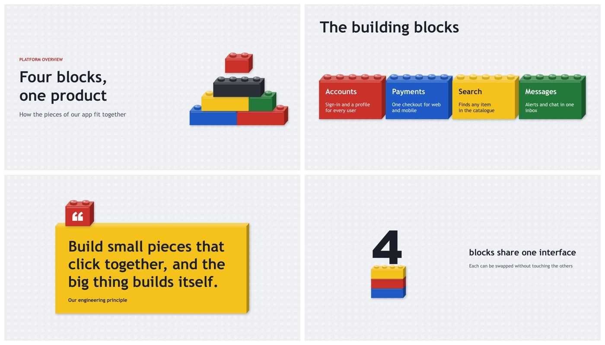</a><br/>
      <sub><strong>积木</strong><br/>儿童教育、模块化产品、系统架构<br/>
      <a href="https://slides.addsum.top/cn/#vl-bricks">查看全部页面</a></sub>
    </td>
    <td align="center" width="20%">
      <a href="https://slides.addsum.top/cn/#vl-boardgame">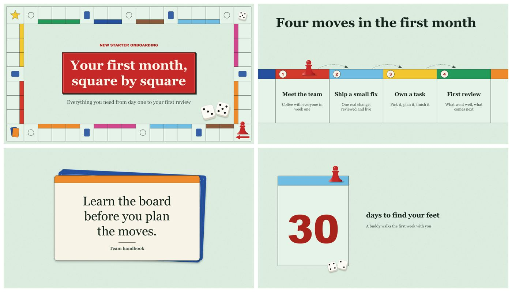</a><br/>
      <sub><strong>棋盘游戏</strong><br/>流程、入职引导、策略<br/>
      <a href="https://slides.addsum.top/cn/#vl-boardgame">查看全部页面</a></sub>
    </td>
    <td align="center" width="20%">
      <a href="https://slides.addsum.top/cn/#vl-circuit"></a><br/>
      <sub><strong>电路板</strong><br/>硬件、物联网、嵌入式<br/>
      <a href="https://slides.addsum.top/cn/#vl-circuit">查看全部页面</a></sub>
    </td>
    <td align="center" width="20%">
      <a href="https://slides.addsum.top/cn/#vl-topo">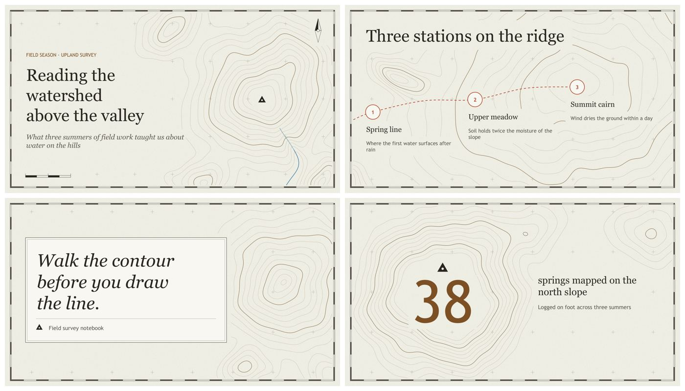</a><br/>
      <sub><strong>等高线地形图</strong><br/>地理、户外、气候<br/>
      <a href="https://slides.addsum.top/cn/#vl-topo">查看全部页面</a></sub>
    </td>
  </tr>
  <tr>
    <td align="center" width="20%">
      <a href="https://slides.addsum.top/cn/#vl-scoreboard"></a><br/>
      <sub><strong>体育记分牌</strong><br/>体育、比赛、团队战绩<br/>
      <a href="https://slides.addsum.top/cn/#vl-scoreboard">查看全部页面</a></sub>
    </td>
    <td align="center" width="20%">
      <a href="https://slides.addsum.top/cn/#vl-periodic">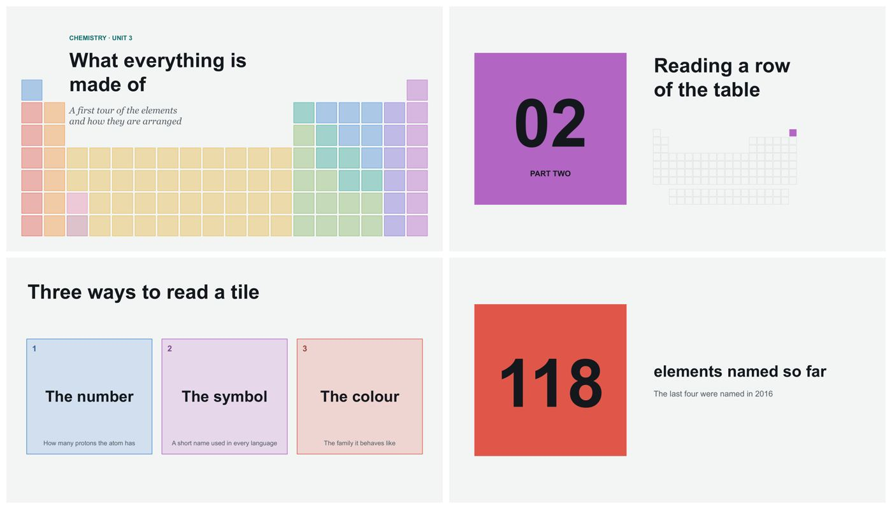</a><br/>
      <sub><strong>元素周期表</strong><br/>科学教育、化学、主题的基本构成<br/>
      <a href="https://slides.addsum.top/cn/#vl-periodic">查看全部页面</a></sub>
    </td>
    <td align="center" width="20%">
      <a href="https://slides.addsum.top/cn/#vl-recipe"></a><br/>
      <sub><strong>食谱卡</strong><br/>美食、烹饪、食谱<br/>
      <a href="https://slides.addsum.top/cn/#vl-recipe">查看全部页面</a></sub>
    </td>
    <td align="center" width="20%">
      <a href="https://slides.addsum.top/cn/#vl-stainedglass"></a><br/>
      <sub><strong>彩绘玻璃</strong><br/>文化遗产、文化活动、庆典<br/>
      <a href="https://slides.addsum.top/cn/#vl-stainedglass">查看全部页面</a></sub>
    </td>
    <td align="center" width="20%">
      <a href="https://slides.addsum.top/cn/#vl-calendar">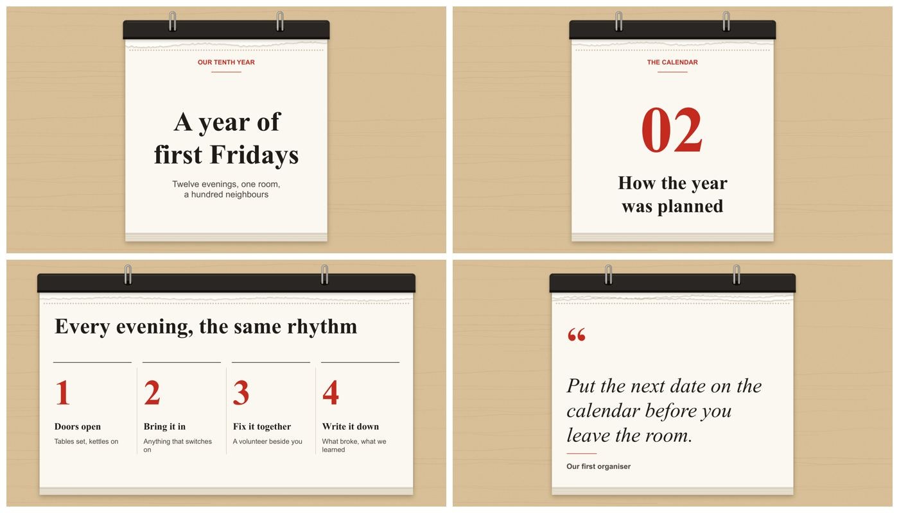</a><br/>
      <sub><strong>撕页日历</strong><br/>时间线、活动、纪念日<br/>
      <a href="https://slides.addsum.top/cn/#vl-calendar">查看全部页面</a></sub>
    </td>
  </tr>
</table>
<!-- /vl -->

<p align="center"><a href="https://slides.addsum.top/cn/#languages"><strong>在线翻看全部<!-- vl:count-all-zh -->三十<!-- /vl -->套模板的配色与页面 →</strong></a></p>

---

## 模板怎么用

先点开喜欢的模板看样张，再把材料、观众和页数一起交给 slide-maker。例如：

```text
用 slide-maker，选择标本图鉴（herbarium）模板，用浅色配色。
根据我的 notes.md，做一份给初中生讲解的 8 页生物课件。
```

没有偏好的模板，说明主题和观众，它会推荐合适的几套。已有学校或公司的 PPTX 模板，也可以直接提供，让它参考字体、配色和版式。


---

## slide-maker 不一样在哪

市面上的 AI PPT 工具大致分四类，slide-maker 只做最后一类：

| 类型 | 输出 | 在 PowerPoint 里能逐元素编辑吗 |
| --- | --- | :---: |
| 模板填空 | 固定模板里塞内容 | 部分能，受模板限制 |
| 图片式 | 每页一张大图打包成 PPTX | 不能，每页是一张图 |
| HTML 网页式 | 浏览器里的幻灯片 | 不是 PPTX |
| **原生可编辑（slide-maker）** | **真实文本框、形状、原生图表** | **能，点哪改哪** |

这张表说的是**格式**。现在已经有几个新工具也能输出原生可编辑 PPTX，所以「可编辑」本身不再是区分点。真正的区别在于：读你的真实材料、拒绝编造；交付前过独立评审；每一页围绕你的内容编排，而不是把文字倒进模板。

### 一支各司其职的 agent 小团队：分工不同，立场也不同

slide-maker 不是一个 prompt 包办一切，而是一组各有专职的 **agent**，每个只做一件事，而且刻意分开，不让同一个「人」既搭 deck 又给它打分：

- **content-planner（内容规划）**：牵头的主编。它把材料真正通读一遍，决定每页**讲什么**：记忆点、证据、整份 deck 的起承转合。每个数字都要能溯源，另有一道覆盖检查，保证材料里的关键点不会被悄悄弄丢，要么上页面，要么明确标注「有意割舍」。整条故事线出自同一个脑子，所以是一条连贯的论证，不是一堆散页拼起来。
- **slide-design（美术总监）**：另一个独立的脑子，负责已经定稿的故事**长什么样**：每页的视觉形式、配色（一种颜色在整份 deck 里只表达一个含义）、字体、节奏、图标，以及哪一页的点击渐显才真正值得做。它先对着内容在白纸上构想，再去翻组件库，所以出来的是「被设计过」，不是「套模板」。
- **critic（评审）**：一个没参与搭建的独立评审。它对着**渲染出来的**页面从两个角度挑毛病，一是内容忠实度（数字和原文对不上、关键点丢失），二是设计（版式挤压、对比度不足、合规但死板），挑出来的一律打回重修。正因为它对这份草稿没有立场，才够诚实。
- **arbiter（仲裁）**：重要场合的 deck 会加这道独立的二次复核：动手改之前，先确认评审挑出来的是真毛病、要改的是真问题，不是在改噪声。
- **asset-prep（素材准备）**：构建期的执行工。你确认设计方案之后，它**并行**把计划里的素材（裁图、公式图、生成插画、图标）做出来，不做任何设计决策，所以再大的 deck 也出得快。

在这个基础上，它还有三件多数工具不做的事：

- **先读懂，再动手。** 论文从第一页读到最后一页，代码库先跑通 README，**什么材料都没有时先联网调研主题**。每个数字、每张图都对回来源，先给你一份结构稿确认，方向对了才开始画页面。它不会把摘要复制到第一页就完事。
- **能编辑的不只是文字。** 数据图优先做成原生 PPT 图表，双击就能改数字；公式默认是可编辑的原生数学文本，不是截图，只有分式、矩阵这类二维排版才退回成渲染图；论文里的图直接从 PDF 裁原图，不重画。
- **讲稿一定给，动画你说了算。** 演讲型 deck 每页备注里都有完整讲稿，拿到手就能直接开讲。点击渐显（一拍一拍地放出内容）是访谈里会问你的一项，不是默认塞给你的：你说要纯翻页，交付的就是静态 deck，那是**正确结果，不是少了功能**。真要动画时，它自己判断哪几页值得做，并且把那几页**整页排完**，不会动一半留一半。

还有一条对反复改版的人最重要：每份 deck 由一个构建脚本生成，脚本和成品放在一起。想换重点、换页数、换模板，说一句话重出一版，不用一页页手工返工。

而且它会**越用越像你的**。当你在好几份 deck 上把同一个偏好朝同一个方向反复调整（数据要鲜亮、边框要克制、不要模板味的卡片、公式要排版化），它会把这些记成一份可携带的口味档案：一个放在注册表根目录、归你所有的纯文本文件，可以逐行查看、修改、删除。之后做 deck 会把它当默认值读进来，你就不用一遍遍重教。它给的只是一个起点，当下这份 deck 你说的话永远优先；全新用户那边则是一张白纸，不预设任何风格。

它不承诺一步出完美成品。它把最费时间的部分干掉——读材料、定结构、排版、画图、写讲稿——然后给你一份真正能继续改的文件。剩下的打磨是你的，这也正是输出原生 PPTX 的意义。

---

## 它是怎么干活的

1. **问清楚。** 给谁看、讲多久、大概几页、现场讲还是发出去自读、要什么风格。你用短句回答就行，没想好就说「你定」，它会自己选一个稳妥的答案，并**在动手前先贴出来**，选错了你扫一眼就能否决，不用等它做完一版再重来（只有主题、素材这类只有你知道的信息才必须问你）。
2. **读材料（或联网调研）。** 论文、文档、代码库，还有 Word、Excel、CSV、图片、视频、音频，以及按目的取舍的整本书，都照原样读进来，一律先做精确提取，绝不从像素里猜数字：图表从 PDF 里裁原图，关键数字逐条核对，没有来源的数字不上页面。手里只有一个主题时，它先联网调研最新信息，再动手。
3. **先确认故事，再确认观感，都在对话里完成。** content-planner 先贴一张紧凑的逐页表（每页讲什么、靠哪张图、整体怎么走），并列出它选中的叙事线和落选的两条、各自输在哪——你能推翻的是结构，不只是措辞；你确认故事之后，美术总监再用同样的方式贴出设计方案（观感、配色、每页形式、动效）。两次确认都很快，而且正好卡在改方向最便宜的两个时刻，全程不用打开任何计划文件。
4. **生成 PPTX。** 版面由代码保证，构建时和渲染后各过一遍自动版式检查，文字溢出、元素遮挡、字体异常都会被拦下——还有一类更少见、也更没人想到要查的：**PowerPoint 根本打不开的文件**。读几何和读像素的检查，在结构上都看不见一个格式非法的部件，所以文件本身也会被校验。实测：一次重复写入的动画元素，让一份 deck 保存不报错、渲染正常、所有版式检查全过，而第一个信号会是 PowerPoint 当着用户的面提示「需要修复」。
5. **先看渲染稿，再独立评审。** 第一版渲染稿先发给你，评审档位由你对着它选：`fast`（默认）到 `thorough`，已经满意就选 `none`。之后渲染图交给评审 agent（重要场合再加一道 arbiter 复核），按演讲场景的标准挑毛病，修完复查，通过才交付到 `~/Downloads/<deck-name>/`。PDF 和浏览器预览不在每次构建时生成，只在交付时才出，因为 deck 还在改的时候，它们一生成就过期。另外**必须有一份记录证明评审确实跑过，才放行**：会跳过检查的模型，和会写「我检查过了」的模型，是同一个。
6. **用自然语言微调。** 还不完美？在对话里说一句就行：「第 7 页改成图表」「删掉引言」「配色暖一点」「压到 10 页」「备注短一点」，它会用同一份脚本干净重出一版。不用自己进 PPT 里逐页拖框调版式，一直改到满意为止。

**成本说明：** 工具免费，唯一开销是你自己的 AI 用量。读材料、定结构、生成这几步都很便宜，**贵的是独立评审这一环**，所以它做成第一版渲染稿出来后、对着 deck 问你的一个问题：

| `review:` | 跑什么 | 实测量级 |
| --- | --- | --- |
| `fast`（默认） | 1 名通才评审、1 轮、前 5 条关键声明查证 | ~6 个 subagent · ~25 万 token · 约 10–20 分钟 |
| `standard` | 2 名单镜头评审（内容 + 设计）、2 轮、前 10 条 | ~12 · ~60 万 · 约 30–60 分钟 |
| `thorough` | 多评审面板 + 仲裁复核、3 轮、全部声明 | ~32 · ~200 万 · 约 1–2 小时 |
| `none` | 不评审——看过已经满意，直接交付 | 0 |

<sub>数字来自一份 12 页 deck 的实测，2026 年 7 月，请当量级看。</sub>

---

## 快速开始

<p align="center">
  
</p>

### 第一步：安装

> **更喜欢从市场一键获取？slide-maker 也已上架
> [腾讯 SkillHub](https://skillhub.cloud.tencent.com/skills/slides-maker) 和
> [ClawHub](https://clawhub.ai/dong845/skills/slide-maker)，其中 ClawHub 那份可以直接装进
> [OpenClaw](https://openclaw.ai)，所以 OpenClaw 用户一样能用 slide-maker。**
> 按对应页面的说明获取即可，然后回来装下面的运行依赖（无论哪种装法都需要）。

slide-maker 依赖三样系统工具：**Python 3.9+**、**LibreOffice**（渲染页面预览，用来做自动版式检查），以及一个给图标用的 **SVG 栅格化器**（librsvg、cairosvg，或任意 Chrome 系浏览器都行）。按你的系统装：

| 系统 | LibreOffice | 图标栅格化 |
| --- | --- | --- |
| macOS | `brew install --cask libreoffice` | `brew install librsvg` |
| Linux | `sudo apt install libreoffice` | `sudo apt install librsvg2-bin` |
| Windows | `winget install TheDocumentFoundation.LibreOffice` | 装好 Chrome 或 Edge（无头调用） |

（Windows 一样能用，只是我们测得少；真碰到环境问题，先跑下面的 `check_env.py` 自查，搞不定就带报错开 issue。）

**这些系统依赖就位后，再把 slide-maker 本体装进来。** 下面这四行会克隆仓库、装好它的 Python 包、并注册成技能：

```bash
git clone --depth 1 https://github.com/addsumtech/slides_maker.git
cd slides_maker
python3 -m pip install -r skills/slide-maker/requirements.txt
python3 skills/slide-maker/scripts/install_skill.py --target both
```

只用一个工具的话，把 `both` 换成 `codex` 或 `claude`。不确定缺什么？[检查命令](#遇到问题)会直接打印修复方法。

**想一行搞定？用 [`npx skills`](https://github.com/vercel-labs/skills) 只装技能本体**（免克隆，约 1.1 MB）：

```bash
npx skills add addsumtech/slides_maker
```

它会先问你装到哪个 agent、哪个范围。技能和内置模板在仓库的 `skills/slide-maker/` 下，在线预览与成品示例放在独立仓库 [slides_maker-site](https://github.com/addsumtech/slides_maker-site)。加 `-g` 装到全局（所有项目），加 `-a claude-code`（或 `-a codex`）跳过 agent 选择，加 `-y` 全程免确认。上面那几个运行依赖照样要装：LibreOffice、一个 SVG 栅格化器，以及 `python3 -m pip install -r skills/slide-maker/requirements.txt`。

**用 Claude Code 的话，也可以把它当插件装**，之后用普通插件命令就能更新：

```text
/plugin marketplace add addsumtech/slides_maker
/plugin install slide-maker@slides-maker
```

装的是同一个技能，只是交给 Claude Code 的插件系统管理，而不是复制到你的技能目录。上面那几个运行依赖照样需要。

### 保持更新

slide-maker 会在问你任何问题之前先查一次版本，**已经是最新就什么都不说**。发现有新版时，它既不会自己偷偷更新，也不会只提一嘴就过去，而是在最开头问你一次：

- **yes**：它替你更新，然后整份 deck 都由新版造出来。你不用管自己当初是怎么装的，它会自己判断并跑对应的命令。
- **no**：不更新，就用现在装的这一版。
- **other**：你本地有自己的改动。它会把哪些是你改的、哪些是新版带来的摆给你看，它不替你做决定。

远端版本信息缓存 24 小时，但**你本地有没有未提交的改动，每次都重新检测，从不用缓存**。因为这一项直接决定要不要覆盖你的文件：如果它信了一天前那句「你的工作区是干净的」，而你今天刚好改过技能里的文件，更新就会把你的改动冲掉。断网时它保持安静，不碍事。

不想被提醒：`export SLIDE_MAKER_NO_VERSION_CHECK=1`。

### 第二步：敲 /slide-maker，逐题回答（最推荐）

效果最稳的方式，是**把它的简短访谈逐题答完**：

```text
/slide-maker
```

访谈会展开成一个可点选的标签页问卷（主题 · 模板 · 用途受众 · 风格语言）：方向键切换、回车选择，每题都带现成选项。它也认得老用户：你存过的模板、做过的主题会合并成一个「用我之前的」选项，放在通用选项旁边，选中才展开清单。**一题一题答完，正是让 deck 变成「你的」而不是通用款的关键**：受众、时长、现场讲还是发出去自读、密度、语言、观感，都会影响方案。短句回答就行，**「你定」永远是合法答案**。（评审档位不在这里问——第一版渲染稿出来后，你对着 deck 再定。）

**赶时间？一句话开场也行，但这是抄近路，不是最佳走法：**

```text
用 slide-maker 按 paper.pdf 做一份 PPT。
```

它直接从你的文件开始，跳过主题那一问，确实方便。但每一个你没回答的问题，都会变成它必须替你做的假设，之后你通常要花更多时间微调回来。**deck 重要的话，就把访谈答完。**（Codex 里没有斜杠命令，同样这些问题会以纯文字出现，功能一样完整，只是要自己打字；Claude Code 的点选体验更顺手。）

无论哪种开场，之后都是一段简短对话，不是写 prompt 考试：

```text
它：开工前问几件事：模板用哪套？给谁看、讲多久、现场还是自读？
    素材只有这份 PDF 吗？中文还是英文，图多字少还是均衡？

你：给导师和组会同学，12 分钟现场讲。只有 paper.pdf。
    中文，图多字少，风格你定。

它：（读完论文）结构稿来了：15 页。第 4 页整页放论文 Figure 1，
    结果页做成能改数字的原生图表……你确认方向，我就开始生成。
```

- **风格由你先挑，不用开口要。** 当它从零给你设计（你自己没有模板）时，会把**四个风格方向渲染出来**，给你一个浏览器链接，等你选完再动手。四个里**至少有一个是为你这个主题原创的**，不是从预设里挑的；另外有一道自动检查会挡掉「四个方向其实是同一件事换四种配色」，所以那是真的让你选，不是走过场。
- 材料放进当前项目，或在请求里写完整路径。**什么材料都没有？** 给个主题就行，它先联网调研，再和你对结构。

其他开场方式：

```text
用 slide-maker 按这个代码仓库做一份技术汇报。
```

```text
我有参考 PPT：/path/ref.pptx。参考它的视觉风格，不要它的内容，用 paper.pdf 重新做一份中文汇报。
```

### 可选：AI 生图

需要封面图、页面配图，或者整套 AI 生成的视觉时，在对话里说一句「需要 AI 生图」。生图有两条路，任选其一：有 Codex 订阅就免 key 直接用它的图片生成；没有的话，配一个 OpenAI API key 走 API 也一样。两样都没有也不影响主流程，照常生成可编辑 PPTX。

---

## 适合什么场景

科研汇报是主场，因为它会解析论文里的问题、方法、结果、图表、表格和公式。但只要你手里有一份需要讲清楚的材料（或者只有一个主题、还没材料），它都能先给你一版能开讲、能继续改的 PPT。

| 你手里有 | 可以先做成 |
| --- | --- |
| 论文、实验结果、论文图表 | 组会与论文精读、会议口头报告、海报、开题、答辩、实验结果汇报 |
| 代码仓库、README、技术文档 | 组会、代码仓库讲解、技术架构、阶段进展、工程复盘 |
| 课程材料、产品资料、市场数据 | 课程分享、产品介绍、市场分析、方案说明 |
| 什么都没有，只有一个主题 | 给它一个主题；agent 团队联网调研最新信息，和你对好结构，再从零做出整份 deck |
| 参考 PPT | 换主题、换内容、重新组织表达：用它的观感，你的材料 |
| 想让同一个故事走出 16:9 | 小红书 3:4 图文卡、方形 1:1、9:16 竖版封面、4:3 会场版、A4 打印一页纸，同一套视觉和组件按画布重排，自动避开平台 UI 安全区 |

---

## 遇到问题

生成 PPT 或渲染预览报错时，按你的环境跑检查命令，多数问题是 Python 依赖或 LibreOffice 没装好：

```bash
# Codex
python3 ~/.codex/skills/slide-maker/scripts/check_env.py

# Claude Code
python3 ~/.claude/skills/slide-maker/scripts/check_env.py
```

缺什么它会直接打印修复命令。

环境之外的问题，比如构建报错、lint 各类提示的白话解释和修法、渲染失败、图片来源、中文排版，都有一个专门的「症状 → 原因 → 修法」排障 FAQ 页：[**Troubleshooting & FAQ**](skills/slide-maker/references/troubleshooting-faq.md)（lint 没通过时，输出末尾也会提示这个页面）。页面里没覆盖到的，欢迎开 issue，带上报错输出。

---

## 安全

本仓库不存放、也不硬编码任何凭证。CI 每次 push 都会扫描，工作树**和全部历史**一起扫，而且是按凭证的**形态**（长度加熵）来扫，不是按前缀。如果有扫描器在这里报出 `sk-` 密钥，它命中的是 CSS 类名（`sk-body`、`sk-split`、`sk-rail`，`sk-` 是 skeleton 骨架的缩写）。[**SECURITY.md**](SECURITY.md) 里写了十秒确认的方法，以及真有问题时怎么报给我们。

---

## 开源协议

[MIT](LICENSE)
