# slide-maker：从你的材料生成可编辑的 PPT

<p align="center">
  <a href="README.md"><strong>English</strong></a>
</p>

<p align="center">
  <a href="LICENSE"></a>
  
  
  
  <a href="https://skillhub.cloud.tencent.com/skills/slides-maker"></a>
</p>

<p align="center">
  <a href="https://clawhub.ai/dong845/skills/slide-maker"></a>
  <!-- vl:vl-badge-zh --><a href="https://slides.addsum.top/cn/#languages"></a><!-- /vl -->
</p>

<p align="center"><sub><a href="https://addsum.top/cn/"><strong>增和科技 Addsum</strong></a> 出品 · 免费开源</sub></p>

slide-maker 是一个生成可编辑 PPT 的开源 AI 技能，可在支持技能的 AI 助手中使用。提供论文、代码仓库、文档或一个主题，它会整理内容、设计页面，生成可在 PowerPoint 中继续编辑的 `.pptx`，并附上构建脚本。

你可以先选模板，也可以提供参考 PPT。生成前确认内容结构和设计方向，生成后查看预览，再决定独立评审的力度。

<p align="center">
  <a href="https://slides.addsum.top/cn/#intro"><strong>视频介绍</strong></a> ·
  <a href="#模板库"><strong>模板库</strong></a> ·
  <a href="#功能与交付"><strong>功能与交付</strong></a> ·
  <a href="#工作流程"><strong>工作流程</strong></a> ·
  <a href="#快速开始"><strong>快速开始</strong></a> ·
  <a href="#遇到问题"><strong>遇到问题</strong></a>
</p>

## 快速开始

先把 slide-maker 安装到你使用的 AI 助手中。支持 `npx skills` 的环境可运行：

```bash
npx skills add addsumtech/slides_maker
```

安装后即可向 AI 助手提出制作需求。首次使用时，slide-maker 会自动检查运行环境；如有缺失，会提示你完成安装。例如：

```text
用 slide-maker，根据 paper.pdf 做一份中文组会汇报。观众是导师和同学，现场讲 12 分钟，约 15 页，图多字少。先给我看内容结构和设计方向。
```

想指定画风，可以先在下方选模板，再复制对应提示词。

## 模板库

内置<!-- vl:count-all-zh -->三十<!-- /vl -->套模板，每套提供两种配色，以及封面、章节、图文、要点、引语、数据、结尾七类页面。字体、图表和页面版式使用同一套设计，实际生成时会按你的内容调整。

搭配图片使用的<!-- vl:count-image-zh -->四<!-- /vl -->套分别是：**杂志（editorial）、柔和（soft）、拼贴（collage）**，用于排版你的照片；**绘本（storybook）**，用于搭配一组插画。其余<!-- vl:count-drawn-zh -->二十六<!-- /vl -->套用可编辑的原生形状构成画面，无需准备配图。

下面是十二套精选模板。点击样张可查看该模板的全部页面和两种配色。

<!-- vl:vl-gallery-zh -->
<table>
  <tr>
    <td align="center" width="33%">
      <a href="https://slides.addsum.top/cn/#vl-editorial">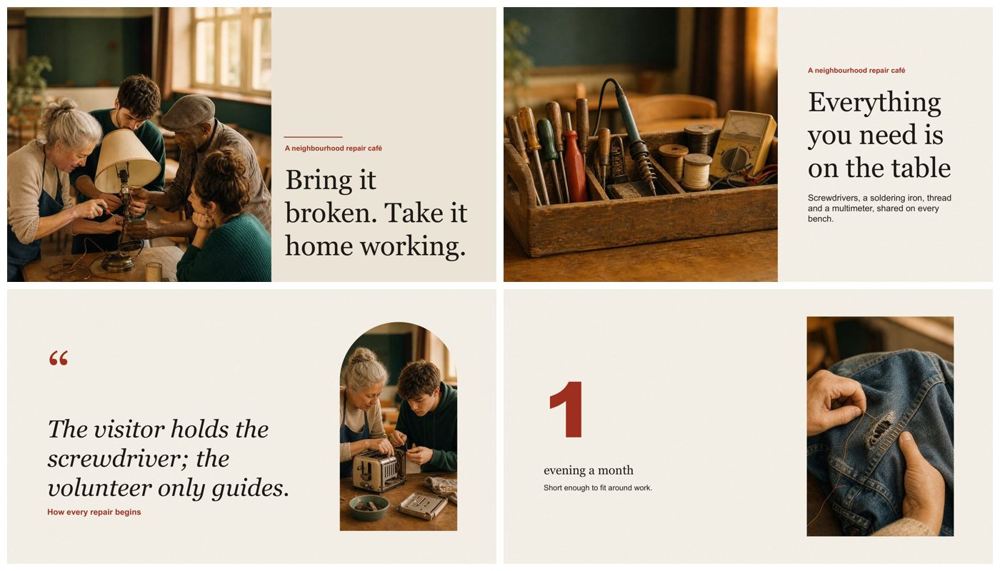</a><br/>
      <sub><strong>杂志</strong><br/>照片排版<br/>
      <a href="https://slides.addsum.top/cn/#vl-editorial">查看全部页面</a></sub>
    </td>
    <td align="center" width="33%">
      <a href="https://slides.addsum.top/cn/#vl-poster">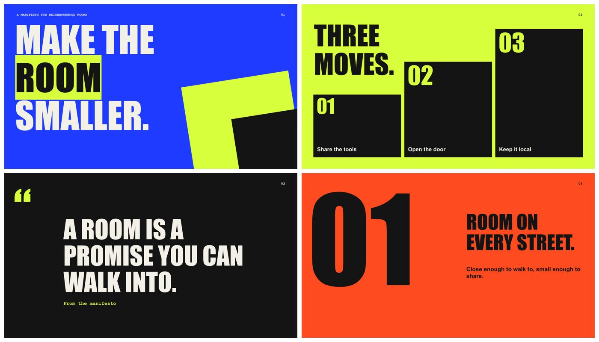</a><br/>
      <sub><strong>海报大字</strong><br/>发布会、宣言、观点<br/>
      <a href="https://slides.addsum.top/cn/#vl-poster">查看全部页面</a></sub>
    </td>
    <td align="center" width="33%">
      <a href="https://slides.addsum.top/cn/#vl-ink">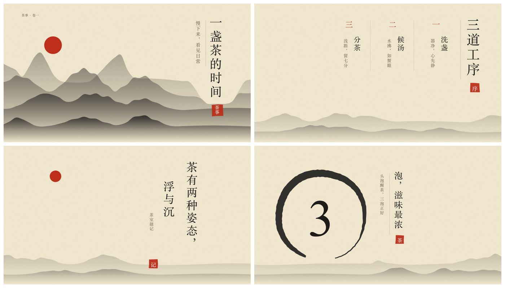</a><br/>
      <sub><strong>水墨</strong><br/>文化、历史、器物<br/>
      <a href="https://slides.addsum.top/cn/#vl-ink">查看全部页面</a></sub>
    </td>
  </tr>
  <tr>
    <td align="center" width="33%">
      <a href="https://slides.addsum.top/cn/#vl-comic">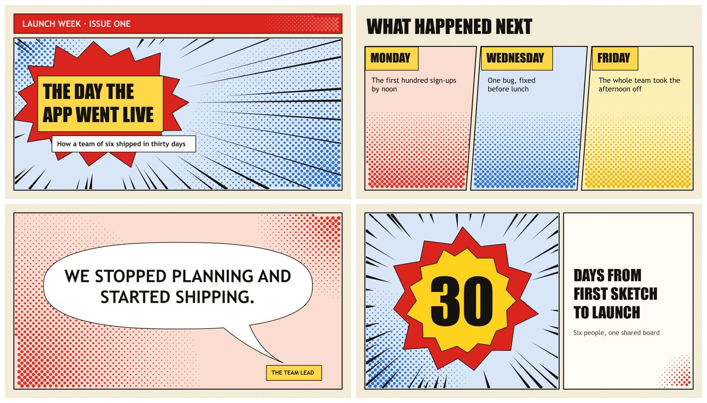</a><br/>
      <sub><strong>漫画分镜</strong><br/>讲故事、用户旅程、科普讲解<br/>
      <a href="https://slides.addsum.top/cn/#vl-comic">查看全部页面</a></sub>
    </td>
    <td align="center" width="33%">
      <a href="https://slides.addsum.top/cn/#vl-vinyl">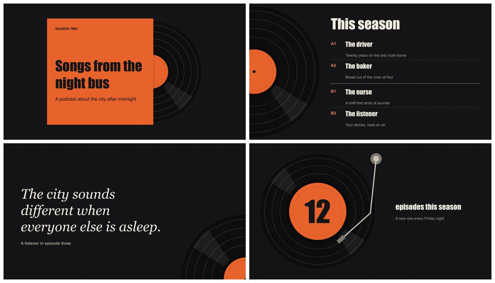</a><br/>
      <sub><strong>黑胶唱片</strong><br/>音乐、播客、文化活动<br/>
      <a href="https://slides.addsum.top/cn/#vl-vinyl">查看全部页面</a></sub>
    </td>
    <td align="center" width="33%">
      <a href="https://slides.addsum.top/cn/#vl-stainedglass">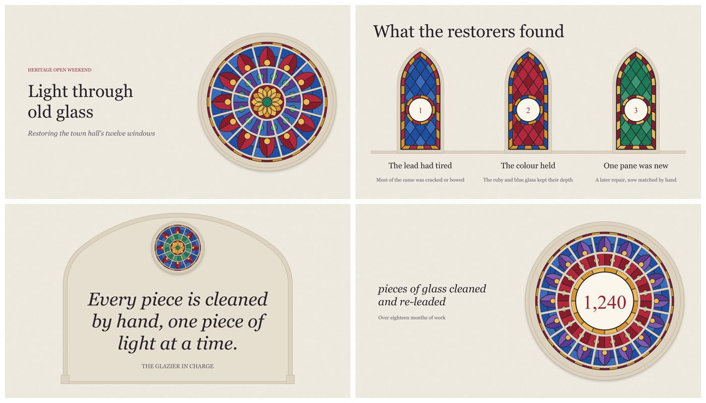</a><br/>
      <sub><strong>彩绘玻璃</strong><br/>文化遗产、文化活动、庆典<br/>
      <a href="https://slides.addsum.top/cn/#vl-stainedglass">查看全部页面</a></sub>
    </td>
  </tr>
  <tr>
    <td align="center" width="33%">
      <a href="https://slides.addsum.top/cn/#vl-wayfinding">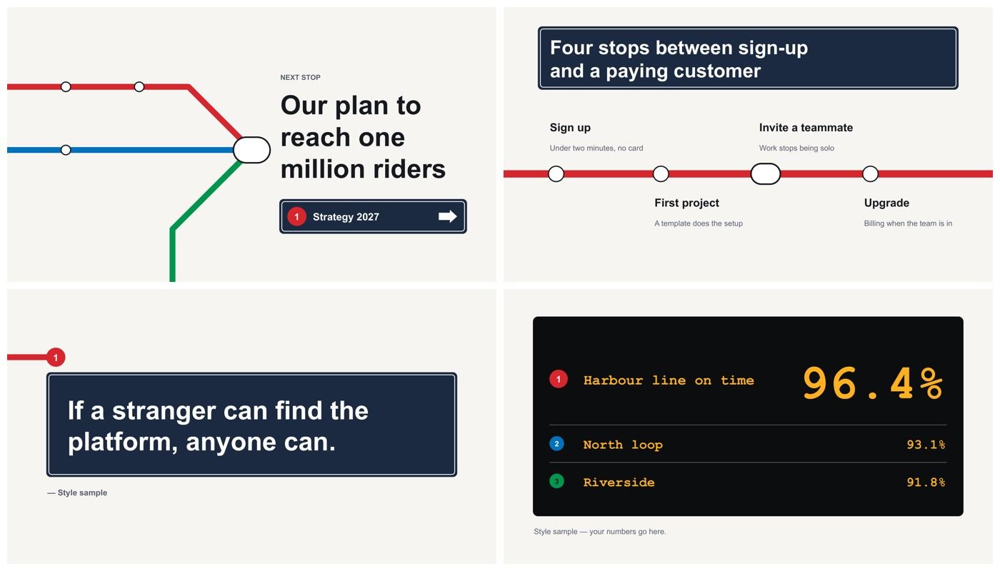</a><br/>
      <sub><strong>导视线路</strong><br/>路线图、流程、新人上手<br/>
      <a href="https://slides.addsum.top/cn/#vl-wayfinding">查看全部页面</a></sub>
    </td>
    <td align="center" width="33%">
      <a href="https://slides.addsum.top/cn/#vl-chalkboard"></a><br/>
      <sub><strong>黑板报</strong><br/>课程、课堂、培训<br/>
      <a href="https://slides.addsum.top/cn/#vl-chalkboard">查看全部页面</a></sub>
    </td>
    <td align="center" width="33%">
      <a href="https://slides.addsum.top/cn/#vl-recipe">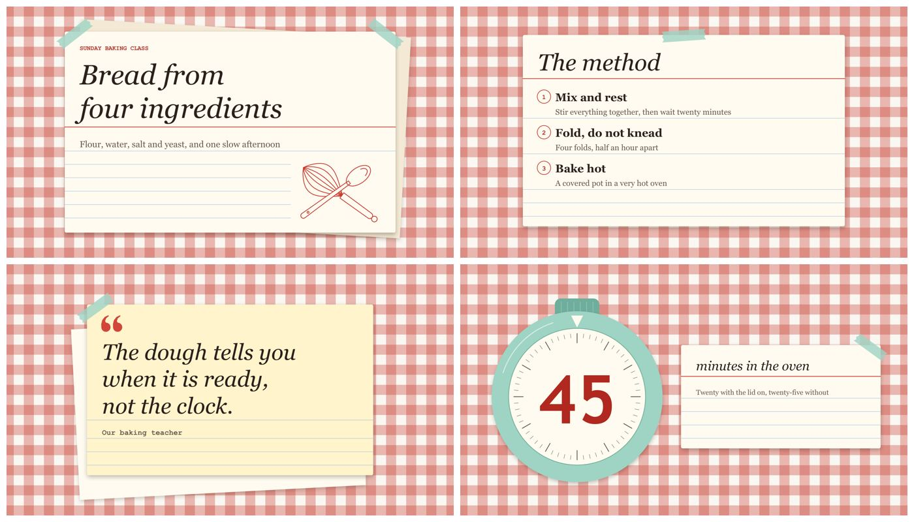</a><br/>
      <sub><strong>食谱卡</strong><br/>美食、烹饪、食谱<br/>
      <a href="https://slides.addsum.top/cn/#vl-recipe">查看全部页面</a></sub>
    </td>
  </tr>
  <tr>
    <td align="center" width="33%">
      <a href="https://slides.addsum.top/cn/#vl-circuit">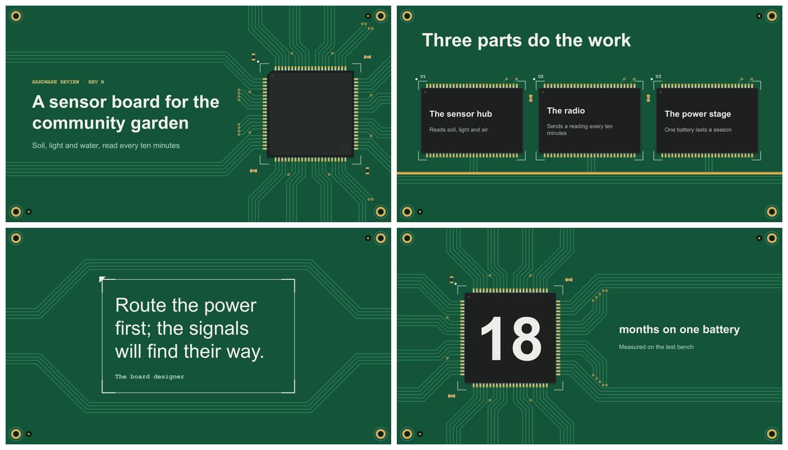</a><br/>
      <sub><strong>电路板</strong><br/>硬件、物联网、嵌入式<br/>
      <a href="https://slides.addsum.top/cn/#vl-circuit">查看全部页面</a></sub>
    </td>
    <td align="center" width="33%">
      <a href="https://slides.addsum.top/cn/#vl-storybook">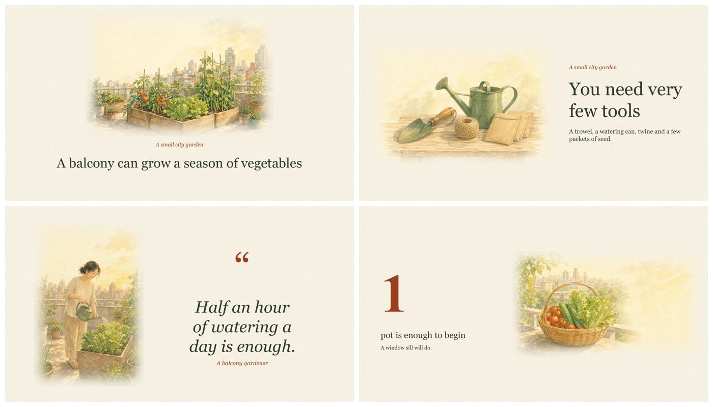</a><br/>
      <sub><strong>绘本</strong><br/>插画叙事<br/>
      <a href="https://slides.addsum.top/cn/#vl-storybook">查看全部页面</a></sub>
    </td>
    <td align="center" width="33%">
      <a href="https://slides.addsum.top/cn/#vl-scoreboard">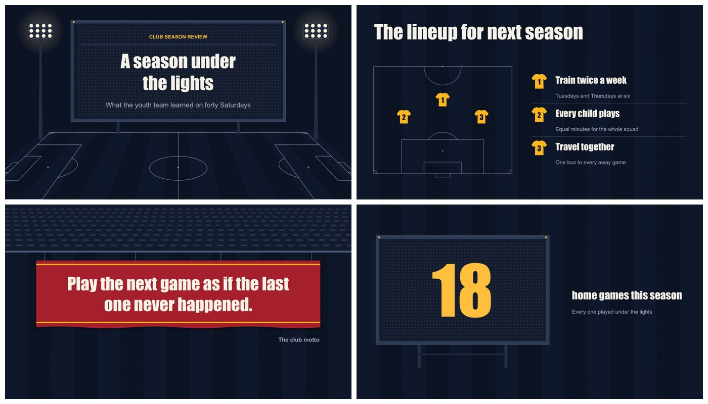</a><br/>
      <sub><strong>体育记分牌</strong><br/>体育、比赛、团队战绩<br/>
      <a href="https://slides.addsum.top/cn/#vl-scoreboard">查看全部页面</a></sub>
    </td>
  </tr>
</table>
<!-- /vl -->

<p align="center"><a href="https://slides.addsum.top/cn/#languages"><strong>查看全部<!-- vl:count-all-zh -->三十<!-- /vl -->套模板</strong></a></p>

### 模板怎么用

在[在线模板库](https://slides.addsum.top/cn/#languages)选好画风，复制提示词，带上材料、观众和页数交给 slide-maker。例如：

```text
用 slide-maker，选择标本图鉴（herbarium）模板，使用浅色配色。根据我的 notes.md，做一份给初中生讲解的 8 页生物课件。
```

不确定选哪套，可以让它按主题推荐。已有学校或公司的 PPTX，也可以提供文件，让它参考字体、配色和版式。

## 功能与交付

| 内容 | 你会拿到什么 |
| --- | --- |
| 可编辑的 PPTX | 文本框、原生形状和原生图表可在 PowerPoint 中修改。照片、插画和裁切的论文图仍以图片保留。 |
| 公式与数据 | 公式优先使用可编辑的数学文本；分式、矩阵等二维排版可能使用渲染图。数据图优先生成原生图表，方便修改数值。 |
| 讲稿与动效 | 演讲型 PPT 附逐页讲稿备注；点击渐显按需要添加，也可以交付静态页面。 |
| 预览与构建脚本 | 交付 PPTX、PDF、浏览器预览和构建脚本，默认放在 `~/Downloads/<deck-name>/`。后续可用同一份脚本继续修改。 |
| 品牌与偏好 | 可从品牌手册、Logo、旧 PPT 或指定色值中提取品牌规范，确认后保存复用。重复使用的设计偏好可记录为可查看、修改和删除的文本文件，当前要求优先。 |
| 版本管理 | 保留构建版本，便于比较差异、恢复整份 PPT 或指定页面。 |
| 多种画布 | 支持 16:9、4:3、1:1、小红书 3:4 图文、9:16 竖版和 A4，按画布重新排版。 |

材料中的关键数字会对照来源核验，论文图优先直接裁取原图。只有主题、没有材料时，会先联网调研，再整理内容。用于正式汇报前，仍需确认关键数据和结论符合你的原意。

## 工作流程

1. 明确需求。 确定主题、材料、观众、时长、页数和风格。没想好的设计细节可以交给它决定，关键假设会在制作前说明。
2. 阅读材料。 提取文字、图表、数据和公式，整理出处；支持论文、代码仓库、Word、Excel、CSV、图片，以及音视频材料。
3. 确认方案。 先看逐页内容结构，再确认字体、配色、版式和动效。没有现成模板时，可以先比较设计方向。
4. 生成与检查。 构建 PPTX，渲染页面，检查文件结构、文字溢出、遮挡和字体等问题。
5. 查看预览并评审。 第一版预览出来后，选择评审档位。独立评审检查内容和设计，修订后复查，再交付文件。
6. 继续修改。 直接说“第 7 页改成图表”“压到 10 页”或“备注短一点”，它会基于原构建脚本重出一版。

### 评审与用量

技能本身免费，运行时使用你的 AI 订阅或 API 额度。页数、材料长度、生图和评审力度都会影响耗时与用量。

| `review:` | 评审范围 |
| --- | --- |
| `fast`（默认） | 一轮内容与设计评审，抽查约五条关键声明。 |
| `standard` | 内容、设计分别评审，最多两轮，抽查约十条关键声明。 |
| `thorough` | 更完整的评审面板与必要的交叉复核，最多三轮，核验全部关键声明，适合答辩、路演等重要场合。 |
| `none` | 看过预览后，由你明确选择跳过独立评审；同时跳过该环节的来源复核。 |

长篇 PPT 会按章节分工评审，并检查整体连贯性。让它“自己决定”时，默认至少运行 `fast`，不会自动跳过评审。

## 安装与环境

### 1. 安装运行依赖

需要 **Python 3.9+**、用于渲染预览的 **LibreOffice**，以及用于处理 SVG 图标的 librsvg、cairosvg 或 Chrome 系浏览器。

| 系统 | LibreOffice | SVG 图标处理 |
| --- | --- | --- |
| macOS | `brew install --cask libreoffice` | `brew install librsvg` |
| Linux | `sudo apt install libreoffice` | `sudo apt install librsvg2-bin` |
| Windows | `winget install TheDocumentFoundation.LibreOffice` | 安装 Chrome 或 Edge |

Windows 的测试覆盖较少，遇到依赖问题可先运行[环境检查](#遇到问题)。

### 2. 安装技能

通过 [`npx skills`](https://github.com/vercel-labs/skills) 安装技能：

```bash
npx skills add addsumtech/slides_maker
```

它会询问安装到哪个工具和作用范围。加 `-g` 可全局安装，`-a claude-code` 或 `-a codex` 可指定工具，`-y` 可跳过确认。首次制作时会自动检查运行环境，缺少依赖时按提示安装即可。

需要保留仓库源码或手动安装时，可以使用以下方式：

```bash
git clone --depth 1 https://github.com/addsumtech/slides_maker.git
cd slides_maker
python3 -m pip install -r skills/slide-maker/requirements.txt
python3 skills/slide-maker/scripts/install_skill.py --target all
```

`all` 会识别本机已有的技能目录；首次安装且没有可识别目录时，会使用通用的 `~/.agents/skills/`。需要指定目录时，可将 `all` 换成 `agents`、`codex` 或 `claude`。

Claude Code 也支持插件安装：

```text
/plugin marketplace add addsumtech/slides_maker
/plugin install slide-maker@slides-maker
```

运行依赖同样需要安装。其他分发入口：[腾讯 SkillHub](https://skillhub.cloud.tencent.com/skills/slides-maker)、[ClawHub](https://clawhub.ai/dong845/skills/slide-maker)；OpenClaw 用户可按 ClawHub 页面的说明获取。

### 3. 开始制作

在已安装技能的 AI 助手中直接提出需求；Claude Code 也可以输入 `/slide-maker`。材料可以放在当前项目中，也可以给出完整路径：

```text
用 slide-maker，根据 paper.pdf 做一份中文组会汇报。观众是导师和同学，现场讲 12 分钟，约 15 页，图多字少。先给我看内容结构和设计方向。
```

它会补问影响方案的信息，例如参考模板、语言、内容密度和是否需要动效。短句回答即可；希望它代选时，可以说“你定”。也可以从代码仓库开始：

```text
用 slide-maker，按这个代码仓库做一份给新同事看的技术介绍，重点讲架构和主要流程。
```

已有参考 PPT 时，说明只参考视觉还是也沿用内容：

```text
参考 /path/ref.pptx 的字体、配色和版式，用 paper.pdf 的内容重新做一份中文汇报。
```

### 更新与可选生图

有新版本时，slide-maker 会先询问是否更新；已是最新或离线时不打扰。远端版本信息缓存 24 小时，本地改动会每次重新检查。需要关闭版本提醒时，设置 `export SLIDE_MAKER_NO_VERSION_CHECK=1`。

需要生成封面或插画时，在对话中说明即可。可使用当前 Codex 环境提供的图片生成工具，或配置 OpenAI API key。生图是可选项，不影响原生文字、形状和图表的生成。

## 适合什么场景

| 你手里有 | 可以制作 |
| --- | --- |
| 论文、实验结果和图表 | 组会、论文精读、会议报告、开题、答辩、学术海报 |
| 代码仓库、README、技术文档 | 架构介绍、项目进展、代码讲解、工程复盘 |
| 课程材料、产品资料、市场数据 | 课件、产品介绍、市场分析、方案汇报 |
| 一个主题 | 联网调研后整理成演示文稿 |
| 参考 PPT | 参考已有设计，用新材料重新组织内容 |
| 需要其他尺寸的内容 | 小红书图文、竖版封面、方形卡片、A4 单页 |

## 遇到问题

生成或渲染报错时，可让助手找到技能内的 `scripts/check_env.py` 并运行。全局安装也可以按实际目录运行：

```bash
# 通用技能目录
python3 ~/.agents/skills/slide-maker/scripts/check_env.py

# Codex
python3 ~/.codex/skills/slide-maker/scripts/check_env.py

# Claude Code
python3 ~/.claude/skills/slide-maker/scripts/check_env.py
```

检查会列出缺失依赖及修复命令。插件安装或项目内安装时，可让助手找到该技能的 `scripts/check_env.py` 并运行。

构建、字体、渲染和图片来源等问题，可查阅 [Troubleshooting & FAQ](skills/slide-maker/references/troubleshooting-faq.md)。仍无法解决时，请在 [Issues](https://github.com/addsumtech/slides_maker/issues) 中附上报错输出。

## 安全与开源协议

安全问题的报告方式见 [SECURITY.md](SECURITY.md)。本项目采用 [MIT 协议](LICENSE)。
